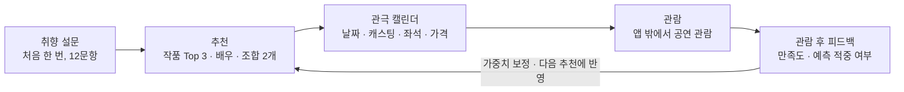

# STAGEFIT(가칭) 서비스 기획서

2026-09-30 · byungyun

STAGEFIT는 뮤지컬을 보기 전에 취향과 관람 조건을 받아, 어떤 작품을 어떤 캐스팅 조합으로 볼지 이유와 함께 추천하는 서비스다. 기존 관극 앱이 관람 후 기록에서 출발한다면, STAGEFIT는 관람 전 선택에서 출발한다.

---

## 문제 정의

뮤지컬은 고를 변수가 많은데, 지금 서비스들은 정보를 보여 주거나 기록을 남기는 데서 멈춘다. 그래서 "나에게 무엇이 맞는지"는 관객이 여러 앱과 커뮤니티를 오가며 직접 판단해야 한다.

- 변수가 많다: 작품, 배우, 회차별 캐스팅 조합, 넘버 스타일, 극장 규모, 좌석
- 실패 비용이 크다: 영화보다 티켓이 비싸고 러닝타임이 길다
- 후기가 팬덤 중심이라 입문자는 해석하기 어렵다
- 같은 작품도 캐스팅에 따라 경험이 달라지지만, 조합을 비교해 주는 서비스가 없다

---

## 타겟 사용자

1차 타겟은 뮤지컬에 관심은 있지만 무엇을 볼지 정하기 어려운 입문~중급 관객이다. 실패하고 싶지 않아서 결정 근거가 가장 필요한 층이다.

| 구분 | 누구 | 주요 고민 | STAGEFIT가 주는 것 |
|---|---|---|---|
| 1차 | 입문~중급 관객 | 작품·배우·조합이 너무 많고, 티켓이 비싸서 실패하기 싫다 | 적합도순 작품 Top 3와 추천 이유 |
| 2차 | 여러 작품을 본 중급 이상 관객 | 이번엔 어떤 캐스트로 볼지, N차 관람 때 어떤 조합이 새로울지 | 캐스팅 조합 추천, 결이 비슷한 배우 추천 |
| 3차 | 처음 입문하려는 사람 | 작품도 배우 이름도 모른다 | "락을 좋아한다" 같은 일반 취향만으로 받는 추천 |

---

## 경쟁 서비스 분석

관람 전에 취향을 직접 받아 작품과 캐스팅 조합까지 추천하는 국내 서비스는 사전 조사에서 확인되지 않았다. 가장 가까운 경쟁자는 기록 기반 맞춤 추천을 내세우는 포도알이다.

| 서비스 | 핵심 기능 | 추천 | STAGEFIT와 다른 점 |
|---|---|---|---|
| 포도알 | 티켓북, 관극 리포트, 항목별 평점(스토리·캐스팅·연출·음향) | 과거 기록 기반 추천 | 선호를 직접 입력받지 않고, 이동시간·좌석 조건을 반영하지 않는다 |
| 플앱(PL@Y2) | 관람 기록, 통계, 애정배우 스케줄 모아보기 | 없음 | 기록·일정 관리 중심 |
| 너겟 | 회차별 캐스팅, 관극 다이어리, 예매내역 자동 인증, 커뮤니티 | 없음 | 조회·기록 중심 |
| 뮤연 | 날짜별 캐스팅 캘린더, 관심 회차 저장 | 없음 | 조합 필터·추천 없음 |
| 연뮤덕 | 공연 일정·캐스팅·가격·넘버 영상 통합 | 없음 | 탐색 도구, 개인화 없음 |
| SeeYa!, 좌석노트 | 극장별 좌석 시야·음향 후기 | 없음 | 추천과 연결되지 않음 |
| NOL 티켓 | 관심 장르·테마 설정 시 티켓 오픈 알림 | 설정 기반 알림 | AI 개인화 강화를 예고해 진입 가능성 있음 |

경쟁사 정보는 2026년 9월 사전 조사 기준이고, 앱 내부 기능은 스토어 설명과 공식 사이트 문구로만 확인했다. 포도알 추천이 실제로 얼마나 정교한지는 직접 써 보고 확인해야 한다.

---

## 포지셔닝과 핵심 가치

**포지셔닝 지도 · 관람 시점 × 개인화 수준** (국내 뮤지컬 관련 서비스, 2026년 9월 사전 조사 기준)

| | ← 관람 후 기록 | 관람 전 선택 → |
|---|---|---|
| **개인화 추천** ↑ | 기록 기반 추천<br>● 포도알 | **관람 전 맞춤 추천**<br>◉ **STAGEFIT — 들어갈 자리**<br>● NOL 티켓 · 설정 기반 알림 |
| **정보 조회·기록** ↓ | 기록·통계<br>● 플앱<br>● 너겟 | 관람 전 정보 조회<br>● 뮤연 ● 연뮤덕<br>● SeeYa! ● 좌석노트 |

관람 후 기록 앱은 여럿이지만, 관람 전에 취향을 받아 개인화 추천을 주는 칸에는 설정 기반 알림(NOL 티켓)만 있다. STAGEFIT는 이 칸을 노린다.

한 줄 포지셔닝은 "기록이 없어도, 관람 전에, 캐스팅 조합까지, 이유를 붙여 추천하는 뮤지컬 관람 의사결정 서비스"다. 포도알이 이미 추천을 내세우므로, 차별점을 "추천" 자체로 말하지 않는다.

1. **실패 확률을 줄인다** — 티켓이 비싸고 공연이 길어서, 예매 전에 만족할지 판단할 근거를 준다.
2. **무엇을 볼지에서 어떻게 볼지까지 좁힌다** — 작품, 캐스팅 조합, 회차 순으로 결정을 돕는다.
3. **이유와 주의점을 설명한다** — 어떤 취향과 맞는지, 어떤 부분은 안 맞을 수 있는지 함께 보여 준다.

---

## 핵심 사용자 흐름

**핵심 루프 · 진입 1단계, 순환 4단계** — 피드백이 다음 추천을 고치는 순환이 재방문 이유가 된다



설문은 처음 한 번만 받고, 그 뒤로는 추천부터 피드백까지가 반복된다. 추천만 하고 기록을 받지 않으면 다시 올 이유가 약해서, 캘린더와 피드백을 MVP에 넣었다.

---

## 기능 명세

MVP에는 설문에서 피드백까지 추천 루프가 한 바퀴 도는 데 필요한 기능만 넣는다. 범위는 2주 미니프로젝트를 가정했고, 좌석·이동시간·예매 연동은 2차로 미룬다.

| 기능 | 설명 | 단계 |
|---|---|---|
| 취향 온보딩 설문 | 스토리 톤, 장르, 넘버 스타일, 극장 규모, 중요 요소 가중치, 가격대를 12문항으로 입력 | MVP |
| 작품 추천 Top 3 | 현재 공연작을 적합도 %로 정렬하고 추천 이유와 주의점 표시 | MVP |
| 배우 취향 입력 | 좋아하는 배우와 좋아하는 이유(음색, 성량, 연기, 캐릭터 해석 등) 입력 | MVP |
| 유사 배우 추천 | 좋아하는 이유가 비슷한, 결이 닮은 다른 배우 추천 | MVP |
| 캐스팅 조합 추천 | 한 작품의 실제 조합 중 성격이 다른 2개를 추천하고 해당 공연 날짜 표시 (예: 가창 중심 vs 감정선 중심) | MVP |
| 관극 캘린더 | 날짜, 작품, 캐스팅, 극장, 좌석, 가격 기록 | MVP |
| 관람 후 피드백 | 작품·배우·넘버·스토리·조합 만족도와 예측 적중 여부를 받아 다음 추천에 반영 | MVP |
| 회차 추천 | 추천 조합이 나오는 회차를 가격, 공연 시간, 잔여석으로 좁혀 제시 | 2차 |
| 이동시간 반영 | 집·직장 기준 이동시간을 추천 점수에 반영 | 2차 |
| 좌석 추천 | 작품 특성에 맞는 구역 추천 (예: 군무가 중요하면 중앙 블록) | 2차 |
| 예매 연동 | 예매처 연결 | 2차 |
| 공식 영상 모아보기 | 라디오 라이브, 뮤비, 하이라이트, 시츠프로브, 프레스콜 링크를 작품·배우별로 모아 추천 조합 아래에 표시 | 보조 |

---

## 온보딩 설문

설문은 12문항으로 제한하고, 문항마다 작품·배우 DB의 같은 항목과 짝을 지어 점수를 계산한다.

| # | 질문 | 선택지 | 추천에 쓰이는 곳 |
|---|---|---|---|
| 1 | 어떤 분위기의 이야기를 좋아하나요? | 파멸 / 감동 / 힐링 / 유쾌 / 긴장감 / 묵직함 | 작품 스토리 톤 태그 |
| 2 | 선호하는 장르는 무엇인가요? | 로맨스 / 스릴러 / 판타지 / 현실극 / 시대극 / 코미디 | 작품 장르 태그 |
| 3 | 어떤 넘버 스타일을 좋아하나요? | 락 / 재즈 / 팝 / 클래식 / 웅장한 앙상블 / 잔잔한 발라드 | 작품 음악 스타일 태그 |
| 4 | 공연에서 가장 중요한 요소 3개를 골라 주세요. | 배우 / 넘버 / 스토리 / 개연성 / 연출 / 무대 | 추천 점수 가중치 |
| 5 | 스토리 개연성이 얼마나 중요한가요? | 1~5점 | 작품 개연성 평가 |
| 6 | 배우의 어떤 점을 가장 중요하게 보나요? | 음색 / 성량 / 가창력 / 연기 / 감정 표현 / 캐릭터 해석 / 춤 / 분위기 | 배우 특성 가중치 |
| 7 | 좋아하는 배우가 있다면 골라 주세요. | 복수 선택 | 유사 배우 추천의 기준점 |
| 8 | 좋아하는 작품이 있다면 골라 주세요. | 복수 선택 | 작품 취향 초기 보정 |
| 9 | 선호하는 공연 규모는? | 대극장 / 중극장 / 소극장 / 상관없음 | 극장 규모 태그 |
| 10 | 한 번 관람에 적정한 티켓 가격대는? | 5만 원 이하 / 5~10만 원 / 10~15만 원 / 15만 원 이상 | 가격 필터 |
| 11 | 공연장까지 이동 가능한 최대 시간은? | 30분 / 60분 / 90분 / 상관없음 | 2차 위치 기반 추천 |
| 12 | 새 작품을 고를 때 어느 쪽에 가까운가요? | 검증된 인기작 / 반반 / 새로운 작품도 적극 탐색 | 추천 다양성 조절 |

외모는 배우의 객관 속성으로 저장하지 않는다. 6번에서 "분위기"를 고르면 세련된 이미지, 소년미, 강한 인상, 부드러운 인상 같은 주관 선호 태그를 추가로 받는다. 관람 경험 수준(입문 / 가끔 / 자주)은 타겟 구분용 추가 문항 후보다.

---

## 데이터 설계

추천에 필요한 데이터는 다섯 묶음이다. 이 중 작품 태그와 배우 특성은 공개 데이터에 없어 직접 만들어야 하고, 이게 가장 큰 작업이자 진입장벽이다.

| 데이터 | 주요 항목 | 출처 | MVP 규모 |
|---|---|---|---|
| 사용자 취향 | 설문 12문항 응답, 중요 요소 가중치, 좋아하는 배우와 이유 | 온보딩 설문 | 사용자별 |
| 작품 태그 | 장르, 스토리 톤(파멸·힐링 등), 넘버 스타일, 개연성, 넘버·배우·스토리 비중, 군무·무대 규모, 극장 규모, 러닝타임, 가격대, 초연/재연 | 직접 태깅 | 현재 공연작 20~30개 |
| 배우 특성 | 음색, 성량, 가창 스타일, 연기 스타일, 감정 표현 강도, 캐릭터 해석, 춤, 잘 맞는 배역 성향 | 직접 태깅 후 사용자 평가 집계로 전환 | 30~50명 |
| 공연·캐스팅 | 공연일, 시간, 배역, 출연 배우, 극장, 가격 | KOPIS API, 제작사 캐스팅 공지 | 태깅한 작품 전체 |
| 관람 피드백 | 전체·스토리·넘버·배우·조합·좌석 만족도, 재관람 의향, 예측 적중 여부 | 관람 후 입력 | 누적 |

태그는 1~5점으로 매기고, 설문 항목과 같은 축으로 맞춘다. 예를 들어 설문에서 락 넘버 선호를 물었다면 작품 DB에도 "락 넘버 정도" 점수가 있어야 계산할 수 있다.

2차 데이터는 극장·좌석(구역별 시야, 단차, 무대 거리, 음향, 가성비)과 이동 기준 위치다. 위치는 역이나 동 단위로만 받고 정확한 주소는 받지 않는다.

> **확인 필요:** KOPIS API가 회차별 캐스팅 스케줄을 주는지. 출연진 목록만 준다면 제작사 캐스팅 공지를 보고 직접 입력한다.

---

## 추천 로직

MVP는 AI 모델 없이 가중치 점수 합산으로 추천한다. 사용자가 중요하다고 고른 요소일수록 점수에 크게 반영된다.

### 작품 적합도

$$\mathrm{Score}(u, w) = \sum_{k} W_k \cdot \mathrm{Match}_k(u, w)$$

u는 사용자, w는 작품, k는 스토리·음악·배우 같은 요소다. W_k는 요소별 가중치(합 100%)이고, Match_k는 사용자 취향과 작품 태그가 그 요소에서 얼마나 가까운지(0~1)다.

| 요소 | 기본 가중치 |
|---|---|
| 스토리 | 25% |
| 음악(넘버) | 25% |
| 배우 | 20% |
| 장르 | 15% |
| 가격·거리 | 10% |
| 극장 규모 | 5% |

4번 문항에서 고른 요소는 가중치를 올리고, 나머지를 줄여 합을 100%로 맞춘다. 올리는 폭은 아직 정하지 않았다. 12번 응답은 인기작과 새 작품의 비율을 조절하는 데 쓴다.

### 유사 배우

배우 특성을 같은 항목의 1~5점 묶음으로 저장한다. 사용자가 좋아하는 이유로 고른 항목(예: 음색, 감정 표현)만 비교해 점수가 가장 가까운 배우를 추천한다.

### 캐스팅 조합

후보는 실제 회차에 있는 조합만 쓰므로, 배역이 8명 이상이어도 모든 경우의 수를 계산하지 않는다. 조합마다 출연 배우 특성으로 가창·연기·감정선 점수를 내고 사용자 가중치로 순위를 매긴다. 1위 조합을 고른 뒤, 강점이 다른 조합 중 최고점을 두 번째로 고른다.

| 조합(예시) | 가창 | 연기 | 감정선 | 이런 사람에게 추천 |
|---|---|---|---|---|
| A | 92 | 75 | 80 | 웅장한 넘버와 성량을 중시하는 사람 |
| B | 78 | 93 | 95 | 스토리 몰입과 섬세한 연기를 중시하는 사람 |

### 피드백 보정

관람 후 예측과 실제 만족도를 비교해 가중치를 고친다. 예를 들어 "넘버 때문에 좋아할 것"이라고 예측했는데 넘버 만족도가 5/5였다면 넘버 가중치를 유지하거나 올린다.

---

## 결과 화면 예시

**결과 화면 와이어프레임 · 1위 카드의 6개 요소** — 추천마다 이유, 주의점, 캐스팅 조합이 함께 나온다

```
┌─ 추천 결과 ───────────── 내 취향 기준 Top 3 ─┐
│
│  [1위]  작품 A                   91% 적합도    ← ① 순위와 적합도
│  ─────────────────────────────────────────
│  맞는 이유                                    ← ② 맞는 이유
│   · 파멸 서사 선호와 일치
│   · 락 기반 넘버 선호와 일치
│   · 배우 중요도가 높은 취향에 적합
│
│  ▌주의                                        ← ③ 주의점
│  ▌개연성을 매우 중요하게 보면
│  ▌만족도가 낮을 수 있음
│
│  추천 캐스팅 조합                              ← ④ 캐스팅 조합 2개
│  ┌──────────────┐ ┌──────────────┐
│  │    조합 A    │ │    조합 B    │
│  │ 가창·성량 중심 │ │ 연기·감정선 중심│
│  └──────────────┘ └──────────────┘
│
│  공식 영상                                    ← ⑤ 공식 영상
│  하이라이트 · 라디오 라이브 · 시츠프로브
│
│  [       캘린더에 담기       ]                 ← ⑥ 캘린더에 담기
│
│  2위  작품 B
│  3위  작품 C
└──────────────────────────────────────────┘
```

| | 요소 | 설명 |
|---|---|---|
| ① | 순위와 적합도 | 취향 점수를 %로 보여 준다 |
| ② | 맞는 이유 | 어떤 취향과 일치하는지 설명한다 |
| ③ | 주의점 | 안 맞을 수 있는 부분도 알려 준다 |
| ④ | 캐스팅 조합 2개 | 핵심 차별 기능, 성격이 다른 두 조합 |
| ⑤ | 공식 영상 | 라디오 라이브·하이라이트로 미리 듣기 |
| ⑥ | 캘린더에 담기 | 추천이 관극 기록으로 이어진다 |

결과 카드 하나에 적합도, 맞는 이유, 주의점, 캐스팅 조합 2개가 함께 보인다. 사용자는 공식 영상으로 조합을 직접 들어 본 뒤 캘린더에 담는다.

---

## 리스크와 대응

가장 큰 리스크는 데이터다. 작품 태그와 배우 특성을 직접 만들어야 하고, 시즌마다 새로 갱신해야 한다.

| 리스크 | 대응 |
|---|---|
| 작품 태그·배우 특성 구축 비용이 크다 | MVP는 현재 공연작 20~30개, 배우 30~50명만 수작업으로 태깅한다 |
| 시즌마다 데이터 갱신 부담이 쌓인다 (연뮤 일정 서비스 뮤킷 종료 사례) | 관람 후 태그 투표로 사용자가 태그를 채우고 보정하게 한다 |
| 회차별 캐스팅 데이터를 못 구할 수 있다 | KOPIS 제공 범위를 먼저 확인하고, 없으면 제작사 캐스팅 공지를 수기로 입력한다 |
| "기존에 없는 추천 앱"이라는 주장은 포도알 때문에 반박된다 | 차별점을 관람 전, 기록 없이, 캐스팅 조합까지, 이유 설명으로 표현한다 |
| 배우 평가는 팬덤에 민감하다 | 점수는 내부 계산에만 쓰고 화면에는 결 태그로 보여 준다. 외모는 사용자 인상 태그로만 받는다 |
| 추천만 하면 다시 올 이유가 약하다 | 캘린더와 피드백 루프로 기록 앱의 재방문성을 가져온다 |
| NOL 등 대형 예매처가 AI 개인화로 들어올 수 있다 | 캐스팅 조합, 결 기반 배우 추천처럼 뮤지컬 관객 특화 기능으로 차별화한다 |

---

## 서비스 이름 후보

1순위는 STAGEFIT다. "나에게 맞는 공연"이라는 콘셉트가 이름에 그대로 들어가고, 한 줄로 설명하기 쉽다.

| 순위 | 이름 | 뜻 | 메모 |
|---|---|---|---|
| 1 | STAGEFIT | Stage + Fit, 나에게 맞는 공연 | 콘셉트가 가장 정확하다 |
| 2 | CURTAIN PICK | Curtain + Pick, 오늘 볼 공연 고르기 | 무난하고 바로 이해된다 |
| 3 | CASTMATE | Cast + Mate | 캐스팅 조합 추천이 잘 드러나지만 작품 추천 느낌은 약하다 |
| 후보 | MYCAST | 나에게 맞는 캐스팅 | 직관적이지만 캐스팅 기능에 치우친다 |
| 후보 | PLAYFIT | Play + Fit | 연극까지 확장하기 쉽다 |
| 후보 | CURTAIN | 커튼 | 예쁘지만 검색성과 차별성이 약하다 |
| 후보 | FITICKET | Fit + Ticket | 서비스명보다 기능명 느낌이다 |

한 줄 소개안은 "STAGEFIT, 내 취향에 맞는 작품과 캐스팅을 찾아 주는 뮤지컬 추천 서비스"다. 상표와 도메인 사용 가능 여부는 아직 확인하지 않았다.

---

## 다음 단계

가장 먼저 할 일은 경쟁 앱을 직접 써 보고, 관객 인터뷰로 관람 전 추천 수요를 검증하는 것이다.

- [ ] 포도알·플앱·너겟을 설치해 추천·통계 화면 캡처 (경쟁 분석 근거)
- [ ] 뮤지컬 관객 5~10명 인터뷰로 관람 전 추천 수요 검증
- [ ] KOPIS API의 회차별 캐스팅 제공 여부 확인
- [ ] 작품 태그 기준표를 만들고 현재 공연작 20~30개 태깅
- [ ] 이름 후보 상표·도메인 확인

---

<!-- 아래는 원문에 없는 변환 메모 -->

## 변환 메모 (원문에 없음)

- 원본: Claude Docs 문서 <https://claude.ai/artifact/Naq5ALnoUnVsWxyGUjBBYF> (2026-09-30 작성)
- 변환일: 2026-10-02. 원문의 다이어그램 3개는 SVG라서 각각 표 / mermaid / ASCII 와이어프레임으로 바꿨다.
- **상태 주의:** 이 문서는 9-30 초기 버전이다. 10-01에 방향이 "조합 우선"으로 바뀌었고(타겟도 연 3~6회 관객으로 좁힘), KOPIS에 회차별 캐스팅이 **없다**는 사실이 확인됐다. 따라서 위의 "설문 12문항 → 작품 Top 3" 뼈대와 데이터 설계의 KOPIS 항목은 현재 방향과 어긋나는 부분이 있다.
