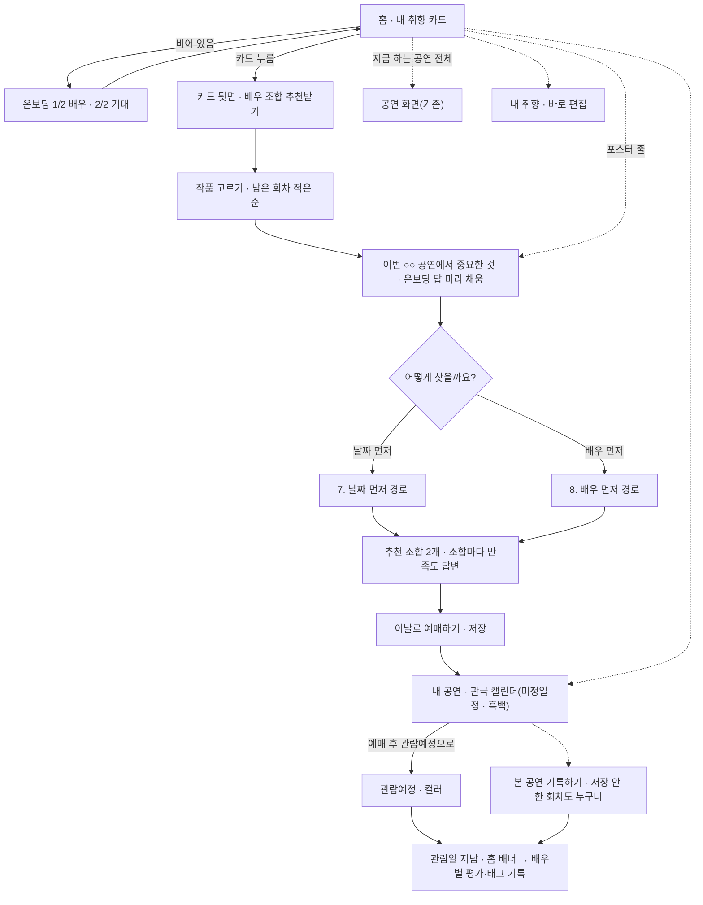
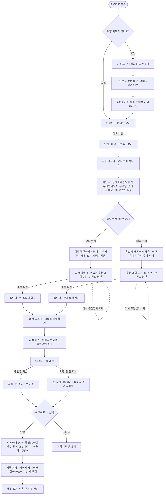
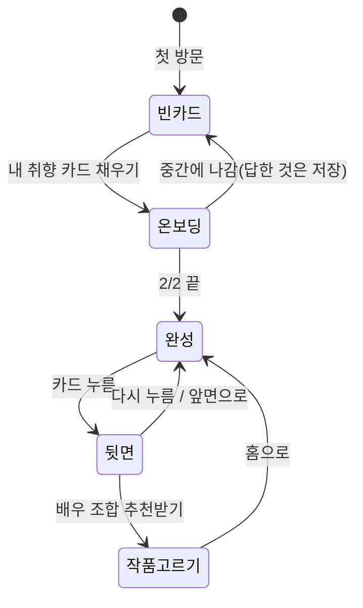
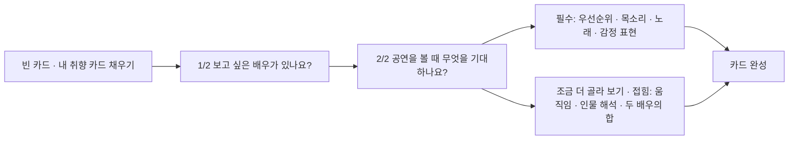
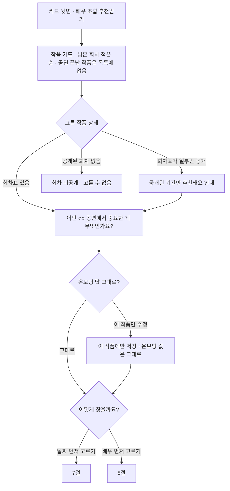
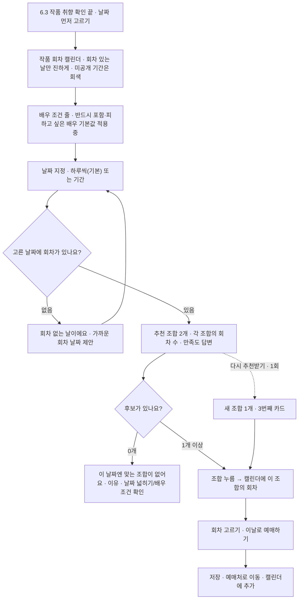
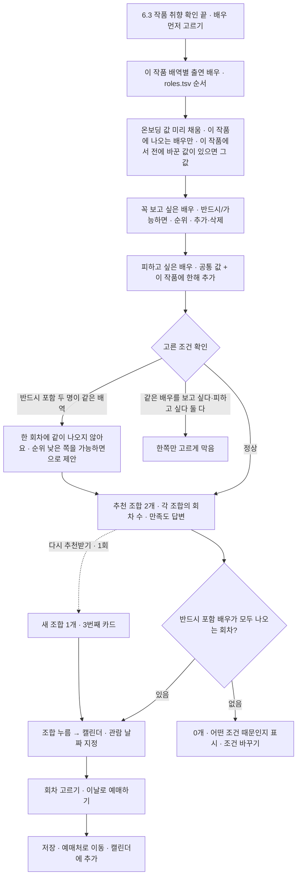
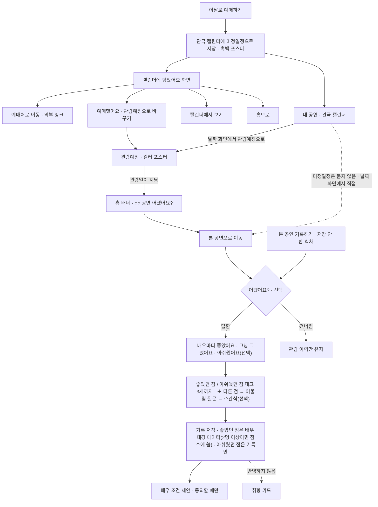

# PICKLE | MVP 사용자 흐름 (배우 조합 추천 중심)

> **팀 공유용 UX 명세 v1.2 · 2026-10-28**
> v1.2(사용자 결정, 1.5절 결정 54~59): ① 홈 취향 티켓 아래에 작품 목록을 되살렸다(「배우 조합 추천받기」 MVP 작품 포스터 줄 + 「지금 하는 공연 전체」). ② 내 공연 탭은 서비스 안 **관극 캘린더**다. 구글 캘린더 파일(.ics) 대신 담은 회차의 포스터로 날짜 칸을 채운다. ③ 담은 회차는 **미정일정**(흑백 포스터)으로 들어가고, 예매한 뒤 사용자가 **관람예정**으로 바꾸면 컬러가 된다. ④ 날짜를 누르면 공연명·날짜·시간·출연배우·장소(자동)와 좌석·금액(직접 입력)이 나온다. ⑤ 관람 후 「어땠어요?」 홈 배너는 관람예정 일정에만 띄운다. 앱 반영은 14절(v1.2), 커밋은 `main` 68de3bd 이후.
> v1.1(사용자 결정): ① 관람 후 알림은 브라우저 푸시 대신 **홈 맨 위 배너**만 쓴다(결정 42를 대신함, 푸시 권한 질문·문구 삭제). ② 홈 취향 카드는 세로로 긴 극장 티켓(블랙+버건디, 커튼·오페라글라스·극장 의자, 칸과 줄): 맨 위 '나의 뮤지컬 관극 취향' → 한 줄 요약(가장 크게) → 분류별 태그 칸 → 왼쪽 아래 「수정하기」(온보딩 처음부터) · 맨 아래 업데이트 날짜. 뒷면의 '답 고치기'는 뺐다. ③ 처음 온 사람은 흐리게 비치는 카드 위에 가장 큰 「내 취향 설정하기」(→ 온보딩). ④ 내 취향 화면은 ①배우 ②기대 ③[확인 → 홈 카드]만 한 줄로 두고, 기록·개인정보 카드(안내 화면 #privacy에 남음)·좌석 등급·끌리는 배우 고르기·관람 기록 상자·저장 안내 문구를 뺐다. 배우 검색 목록은 KOPIS 출연진 전체(한글 이름 먼저, 영어 이름 뒤). 기대 질문의 '상관없어요'는 기본으로 켜 두지 않는다.
> v1.0: 이 문서의 결정을 앱에 반영했습니다(`pickle-src` 브랜치 `feature/mvp-flow`, 커밋 053638b). 결정은 바꾸지 않았고, 14절을 '앱 반영 현황'으로 다시 썼습니다. 앱에 아직 없는 것은 서버가 필요한 두 가지(관람 후 서버 푸시, 리뷰 태그 여러 사용자 집계)와 데이터 정리 하나(`roles.tsv` 시카고 두 배역)입니다. 구현하면서 정한 세부 동작은 14.2절에 적었습니다. 5.5절의 '선명하고 쨍한 음색' 근거 수(5건)를 채웠습니다. 실제 사이트(`2ma1995.github.io/pickle`)는 `main` 브랜치로 배포하므로, 이 브랜치를 `main`에 합치기 전까지 사이트는 바뀌지 않습니다.
> v0.9: 관람 후 리뷰와 조합 만족도를 보완했습니다(결정 46~53). 관람 후 리뷰에 배우별 평가(좋았어요 / 그냥 그랬어요 / 아쉬웠어요, 선택)를 다시 넣고, 아쉬웠던 점 태그는 기록만 합니다. 태그는 배우마다 3개까지, 「＋ 다른 점」으로 전체 배우 태그를 열 수 있고, 조합 태그는 배우 줄에서 빼고 마지막 질문으로 받습니다. 저장하지 않은 회차도 누구나 「본 공연 기록하기」로 남길 수 있고, 리뷰 태그는 서로 다른 사용자 2명 이상이 남겼을 때 추천 점수에 씁니다(결정 44 수정). 「다른 배우였어요」 캐스트 수정, 리뷰 뒤 배우 조건 제안(동의할 때만), '누구 때문인가요?'의 「추천 이유가 와닿지 않아요」 칩, 중간 만족도와 관람 후 평가를 잇는 지표를 넣었습니다.
> v0.8: D-24 반영 방식과 D-28 세부 값(배우당 +0.5, 조합당 상한 +1.5, 같은 배우 한 번만, 별로예요 조합은 이번 시즌 동안 제외)을 사용자 결정으로 확정했습니다(결정 45).
> v0.7: D-23~D-27을 사용자 결정으로 확정해 1.2절(결정 40~44)로 옮겼습니다. 관람 후 주관식은 공개/비공개를 사용자가 고르고(기본 비공개), 조합 만족도는 다음 추천에 반영하며(10.3절 제안 메커니즘, 세부 값은 확인 필요), 관람 후 알림은 브라우저 푸시로 보냅니다. 관람 후 리뷰 태그는 배우마다 4단계 우선순위로 띄우고, 그 기록은 바로 '확정' 배우 태그로 저장합니다.
> v0.6: 사용자 요청을 반영했습니다. 작품을 고른 뒤 '이번 ○○ 공연에서 중요한 것'을 확인하는 단계(6.3절)를 넣었습니다. 관람 후 흐름(알림 → 본 공연으로 이동 → 어땠어요?(선택) → 기록 저장 / 건너뛰면 관람 이력만 유지)은 두고, '어땠어요?'를 3지선다 대신 태그 형식 리뷰(배우별 태그 선택 + 주관식 → 배우 태깅 데이터)로 바꿨고(11절), 추천 직후 조합 만족도 답변(10.2절)을 넣었습니다. 시카고 에이모스 하트·메리 선샤인을 추천 단위에서 뺐고, 남은 결정을 모두 확정해 1.2절(결정 24~39)로 옮겼습니다. 새로 생긴 확인 필요 항목은 16절에 있습니다.
> 이전 판: v0.5(D-01·04·05·07·16·22 확정), v0.4(17시 결정 반영·주연/조연 구분 삭제), v0.3(확정 온보딩으로 교체), v0.2(추천 단위·태그 상태 확정), v0.1(초안).
> 기준 문서는 `PICKLE 전체 사용자 흐름 시각화.md`(v2.0, 2026-10-21)와 `pickle-src/docs/261027_1.md`이고, 두 문서는 고치지 않았습니다. v0.9까지는 문서만 고쳤고, v1.0에서 앱 코드(`app/index.html`)·`recommend.py`·테스트를 이 문서에 맞췄습니다. 데이터(`roles.tsv` 등)는 고치지 않았습니다. 반영 현황은 14절에 있습니다.

## 문서 읽는 방법

- `mermaid` 코드 블록은 GitHub, Notion, Mermaid를 지원하는 Markdown 뷰어에서 흐름도로 보입니다.
- 화면 문구와 선택지는 각 절의 표가 기준입니다. 흐름도는 순서와 분기만 보여 줍니다.
- **[확인 필요]**는 팀 결정이나 데이터 확인이 남은 부분입니다. 16절에 모아 두었습니다.
- 회차 날짜는 작성 시점의 `pickle-src/app/data.js` 기준입니다. 데이터가 갱신되면 13.1절 날짜도 바뀝니다.
- 이 문서는 주연/조연(비중)을 쓰지 않습니다. 작품의 핵심 배역은 모두 같은 무게이고, 표시 순서는 `data/mvp/roles.tsv`의 배역 순서입니다(10.1절에서 뺀 배역 제외).

---

## 1. 이번 MVP에서 정한 것

### 1.1 MVP 범위 결정 (2026-10-27)

| # | 결정 | 반영한 곳 |
| --- | --- | --- |
| 1 | 작품은 엘리자벳·겨울왕국·레베카·스위니토드·시카고 5개로 제한한다. 작품을 추천하는 화면·데이터·문구는 모두 뺀다. 배우 조합 추천이 중심이다. | 2, 6절, 15절 |
| 2 | 첫 화면은 내 취향 카드다. 비어 있으면 2단계 온보딩(1/2 배우, 2/2 기대)에 답해 채운다. | 4, 5절 |
| 3 | 완성된 카드를 누르면 뒤집히고 '배우 조합 추천받기' 버튼이 나온다. | 4.3절 |
| 4 | 버튼을 누르면 5개 작품 중 하나를 고르고, 작품 취향을 확인한 뒤(결정 24), '날짜 먼저 고르기' / '배우 먼저 고르기' 중 하나를 고른다. | 6절 |
| 5 | 날짜 먼저: 작품 회차 캘린더 → 날짜를 하루씩 또는 기간으로 지정 → 그 날짜의 추천 조합 → 조합을 누르면 캘린더에 가능한 회차 → '이날로 예매하기' → 저장 | 7절 |
| 6 | 배우 먼저: 온보딩 배우 조건이 미리 채워진 화면에서 이 작품의 꼭 보고 싶은 배우(순위)·피하고 싶은 배우 조정 → 추천 조합과 회차 → 캘린더에서 관람 날짜 지정 → 저장 | 8절 |
| 7 | 추천 조합은 2개. '다시 추천받기'는 1회, 새 조합 1개를 제안한다. | 10절 (보여 주는 방식은 결정 18) |

### 1.2 이번 결정 (2026-10-27 17시 ~ 2026-10-28)

| # | 결정 | 반영한 곳 |
| --- | --- | --- |
| 8 | 온보딩 1단계에서 고른 꼭 보고 싶은 배우(반드시 / 가능하면)와 피하고 싶은 배우는 모든 작품의 기본값이다. | 5.1, 9절 |
| 9 | '배우 먼저' 경로는 고른 작품의 출연 배우 중에서 온보딩 값을 미리 채워 보여 주고, 그 작품 안에서 순위 지정·추가·삭제할 수 있다. | 8, 9절 |
| 10 | 피하고 싶은 배우는 전 작품 공통으로 적용하고, '배우 먼저' 화면에서 그 작품에 한해 추가할 수 있다. | 8, 9절 |
| 11 | '날짜 먼저' 경로에도 반드시 포함·피하고 싶은 배우 조건을 그대로 적용한다. | 7, 9절 |
| 12 | '반드시 포함'은 배역과 상관없이 적용한다. 고른 작품에 그 배우가 없으면 「이 작품에는 ○○ 배우가 나오지 않아요」라고 안내한다(작품 고르기 화면에서는 안내하지 않음, 결정 25). | 9, 13절 |
| 13 | 주연/조연(비중) 구분을 쓰지 않는다. 추천 단위·조합 카드 표시·정렬·'반드시 포함' 규칙·근거 표시 모두 같다. | 전체, 10.1절 |
| 14 | 작품 추천 관련(공연 카드, 작품 태그로 고르기, 홈의 다른 공연·작품 추천 목록)은 모두 MVP에서 뺀다. | 15절 |
| 15 | 온보딩은 2단계다. 1/2 보고 싶은·피하고 싶은 배우, 2/2 기대(필수 4개 + '조금 더 골라 보기' 선택 3개). 공연 카드 단계는 없다. | 5절 |
| 16 | 작품마다 다른 새 취향 질문과 '집중 배역' 질문은 두지 않는다. 같은 기대 질문을 작품별로 확인·수정하는 단계는 결정 24로 넣는다. | 6.3, 15절 |
| 17 | 첫 화면은 이 문서 기준(취향 카드 → 뒤집어 '배우 조합 추천받기')이다. 앱과 다른 점은 14절에 '변경 필요'로 적는다. | 4, 14절 |
| 18 | (D-01) '다시 추천받기'의 새 조합 1개는 3번째 카드로 붙인다. 기존 2개는 그대로 둔다. | 10절 |
| 19 | (D-04) 날짜 지정은 '하루씩'이 기본이고 '기간'은 토글로 바꾼다. | 7절 |
| 20 | (D-05) 날짜 먼저 경로에서 조합을 누르면 고른 날짜 안의 회차만 보이고, 밖의 회차는 「다른 날짜도 보기」로 펼친다. | 7절 |
| 21 | (D-07) 2/2 질문을 모두 '상관없어요'로 건너뛴 사람도 추천을 받는다. 추천 이유는 배우 근거만으로 쓴다. | 4.1, 5절 |
| 22 | (D-16, v0.5) 엘리자벳은 공연 종료 후 「공연 종료」로 남긴다. → **v0.6에서 결정 35로 바뀜** | — |
| 23 | (D-22) 온보딩 2/2 제목은 「공연을 볼 때 무엇을 기대하나요?」다. | 5.2절 |
| 24 | 작품을 고른 뒤, 날짜 먼저 / 배우 먼저를 고르기 전에 「이번 ○○ 공연에서 중요한 게 무엇인가요?」를 묻는다. 온보딩 2/2 답을 기본값으로 채워 두고 이 작품에서만 고칠 수 있다. 온보딩 값은 바뀌지 않는다. | 6.3, 9.3절 |
| 25 | 작품 고르기 화면(6.1)에는 배우 조건 안내(「이 작품에는 ○○ 배우가 나오지 않아요」 등)를 넣지 않는다. | 6.1절 |
| 26 | 관람일이 지나면 알림을 보내고, 본 공연으로 옮긴 뒤 「어땠어요?」(선택)를 묻는다(건너뛰면 관람 이력만 유지). 3지선다 대신 그 사용자가 온보딩에서 고른 태그를 띄우고, 관람한 회차의 배우마다 어느 태그에 해당했는지 고르게 한 뒤 주관식 기록을 받는다. 이 기록은 취향 카드에 반영하지 않고 '배우 태깅'(근거 성격: 직접 관람 / 사용자 관람 기록)으로 저장한다. → **v0.9에서 결정 46·47로 보완**(배우별 평가 추가, 태그 3개까지) | 11, 12절 |
| 27 | 추천 직후 조합마다 「이 조합이 마음에 들어요 / 별로예요 / 모르겠어요」 답변을 받는다. | 10.2절 |
| 28 | 시카고 에이모스 하트·메리 선샤인은 추천 단위에서 뺀다. | 10.1, 14절 |
| 29 | (D-03) 배우 먼저 화면의 순위는 '가능하면 포함' 배우끼리의 우선순위로 쓰고, 반드시 포함 배우끼리 충돌하면 어느 쪽을 '가능하면'으로 바꿀지 제안하는 데 쓴다. | 8, 9.2절 |
| 30 | (D-06) 배우 먼저 화면에서 작품별로 바꾼 조건은 작품별로 기억한다. 작품 취향 확인(결정 24)에서 바꾼 값도 같은 규칙으로 작품별로 기억한다. | 9.2, 9.3절 |
| 31 | (D-08) 「배우 조합 추천받기」는 카드 뒷면에서만 연다. 카드 밖 바로가기는 두지 않는다. | 4.3절 |
| 32 | (D-11) 작품 카드는 남은 회차가 적은 순으로 보여 준다. | 6.1절 |
| 33 | (D-13) 관람 후 기록은 취향 카드에 반영하지 않는다. 결정 26대로 배우 태깅으로 저장한다. | 11절 |
| 34 | (D-15) 회차표가 공개되지 않은 기간은 캘린더에 회색 「회차 미공개」로 보이고 추천 대상이 아니다. | 7, 13절 |
| 35 | (D-16) 공연이 끝난 작품(엘리자벳은 11/15 이후)은 작품 고르기 목록에서 뺀다. | 6.1, 13.1절 |
| 36 | (D-17) 겨울왕국·시카고 회차표가 공연 기간보다 짧은 이유는 데이터 갱신을 확인한 뒤 13.1절을 고친다. | 13.1절 |
| 37 | (D-19) 우선순위 2배·배역 싱크로 +0.5 임시값은 베타 첫 주 결과(추천 노출·저장)를 보고 조정한다. | 5.4절 |
| 38 | (D-20) `recommend.py`(CLI) 점수도 앱의 새 점수 규칙(배역 무게 같음 포함)에 맞춘다. | 14절 |
| 39 | (D-21) '내 취향' 화면 안에서 취향(배우 조건·기대 답)을 바로 고친다. | 2, 4.3절 |
| 40 | (D-23) 관람 후 주관식 기록은 사용자가 공개/비공개를 직접 고른다. 기본값은 비공개다. 공개하면 추천 근거 문장에 익명으로 보일 수 있다(초안). 원문 외 개인정보(이름·연락처·계정)는 저장하지 않는다. | 11.1, 12절 |
| 41 | (D-24) 조합 만족도는 다음 추천에 반영한다. 별로예요 → 같은 조합 다시 추천 안 함 + 「누구 때문인가요?」 선택 질문, 마음에 들어요 → 그 작품 추천에서 배우당 +0.5, 모르겠어요 → 기록만. 다시 추천받기는 이미 보여 준 조합과 별로예요 조합을 빼고 고른다. 서비스 전체 집계는 MVP에서 기록만 한다. 세부 값은 결정 45. | 10.2, 10.3절 |
| 42 | (D-25) 관람 후 알림은 브라우저 푸시 알림 권한을 받아 보낸다. 권한은 '이날로 예매하기' 저장 직후 「관람일이 지나면 알려 드릴까요?」로 묻고(초안), 거부하면 앱 안 알림 카드로 대신한다. | 11절 |
| 43 | (D-26) 관람 후 리뷰에 띄울 태그는 배우마다 ① 그 작품에서 고친 기대 값(6.3) → ② 온보딩 태그 → ③ 태그를 하나도 안 고른 사람은 우리 데이터의 그 배우 이번 배역 태그 → ④ 그것도 없으면 그 배우의 일반 태그(다른 작품) 순서로 정한다. → **v0.9에서 결정 47로 보완**(기본 칩으로 쓰고 「＋ 다른 점」 추가, 조합 태그 제외) | 11.1절 |
| 44 | (D-27) 관람 후 기록으로 만든 배우 태그는 바로 '확정'으로 저장해 추천에 쓴다(근거 수준 '직접 관람', 근거 성격 '관람평'). 한 사용자가 같은 배우·태그를 여러 번 남겨도 출처 1건으로 센다. → **v0.9에서 결정 49로 바뀜**(서로 다른 사용자 2명 이상일 때 점수에 씀) | 12절 |
| 45 | (D-28, 2026-10-28) 만족도 반영 세부 값: '마음에 들어요'는 배우당 +0.5, 조합당 상한 +1.5, 같은 배우가 여러 조합에서 받아도 한 번만 센다. '별로예요' 조합은 그 작품의 이번 시즌 동안 다시 추천하지 않는다. 반영 방식(10.3절)은 제안대로 확정. | 10.3절 |

### 1.3 v0.9 결정 (2026-10-28, 관람 후 리뷰·조합 만족도 보완)

| # | 결정 | 반영한 곳 |
| --- | --- | --- |
| 46 | 관람 후 리뷰에서 배우마다 「좋았어요 / 그냥 그랬어요 / 아쉬웠어요」를 고른다(배우마다 선택, 안 고른 배우는 건너뜀). 좋았어요 → 「어떤 점이 좋았나요?」 태그, 그냥 그랬어요 → 태그 단계 없음, 아쉬웠어요 → 「어떤 점이 아쉬웠나요?」 태그. 아쉬웠던 점 태그는 `−태그`로 **기록만** 하고 배우 태그·추천 점수에 쓰지 않는다(비선호 감점 없음 원칙, 261027_1.md 2절 #5). | 11.1, 12절 |
| 47 | 리뷰 태그는 배우마다 **3개까지**. 기본 칩은 결정 43 순서(①~④)로 정하고, 줄 끝 「＋ 다른 점」을 누르면 노래·연기·몸 영역의 배우 태그 전체가 열린다. 조합 태그(두 배우의 합 질문 태그)는 배우 줄에 띄우지 않고 마지막 선택 질문 「배우들끼리 어떤 점이 잘 어울렸나요?」로 받는다. 온보딩 질문에서 온 태그는 온보딩 문구로 보여 준다(예: `감정 전달형` → 「감정이 전해지는 노래」). | 11.1절 |
| 48 | 관람 후 리뷰는 **누구나** 쓸 수 있다. 내 공연에 저장하지 않은 회차도 「본 공연 기록하기」에서 작품 → 날짜 → 회차를 고르면 그 회차 캐스트가 채워진다. 지난 회차만 고를 수 있고, 한 사용자는 한 회차에 리뷰 1개(다시 열면 고치기). | 11.2, 13절 |
| 49 | 리뷰로 남긴 배우 태그(좋았던 점)는 **같은 배우·태그를 서로 다른 사용자 2명 이상이 남겼을 때** '확정'으로 추천 점수에 쓴다. 1명뿐이면 기록만 하고 점수에 쓰지 않는다. 근거 수준 '직접 관람', 근거 성격 '관람평', 사용자 1명 = 출처 1건은 결정 44 그대로. | 12절 |
| 50 | 리뷰의 배우 줄마다 「다른 배우였어요」를 둔다. 누르면 그 배역의 다른 배우 중에서 바꾸고, 평가·태그는 바꾼 배우에게 저장한다. | 11.1, 13절 |
| 51 | 리뷰를 저장한 뒤 배우 조건을 제안한다(동의할 때만, 기본은 선택 안 됨): 좋았어요 배우 → 「꼭 보고 싶은 배우(가능하면 포함)에 넣을까요?」, 아쉬웠어요 배우 → 「피하고 싶은 배우에 넣을까요?」. 넣으면 전 작품 기본값(온보딩 1/2 값)에 들어간다. 사용자가 직접 고르는 것이라 결정 33(관람 후 기록을 취향 카드에 자동 반영하지 않음)과 부딪히지 않는다. | 11.1절 |
| 52 | 조합 만족도 '별로예요' 뒤 「누구 때문인가요?」에 「추천 이유가 와닿지 않아요」 칩을 더한다. 점수는 바꾸지 않고 기록해 가중치 조정(결정 37)에 쓴다. | 10.2, 10.3절 |
| 53 | 중간 만족도 답(10.2절)과 관람 후 배우별 평가(11.1절)를 같은 회차 조합으로 묶어 '마음에 들 것 같다던 조합이 실제로 좋았나'를 본다. 결정 37의 가중치 조정 근거(추천 노출·저장)에 이 지표를 더한다. | 10.2, 11.1, 16절 |

v0.9에서 검토했지만 넣지 않은 것: 두 추천 조합 중 하나를 고르게 하는 질문(카드마다 이미 답변이 있어 응답 부담만 커짐), 만족도 문구 변경(결정 27 문구 유지), 관람 후 기록의 취향 카드 자동 반영(결정 33 유지).

### 1.4 이전에 정해져 반영한 것

| 정한 날 | 결정 | 반영한 곳 |
| --- | --- | --- |
| 2026-10-07 | 추천 단위는 두 배우 페어가 아니라 **작품 핵심 배역 전체의 캐스트 조합**이다. 배역은 `data/mvp/roles.tsv` 기준이다(결정 28로 시카고 2개 배역 제외). | 10.1절 |
| 2026-10-27 | 후보·검수 필요 태그를 베타에서 확정으로 올려 추천에 쓴다(원래 상태는 보존). | 12절 |
| 2026-10-27 | 기대 질문의 선택지·태그 매핑·점수 규칙은 `pickle-src/docs/261027_1.md` 3·4절대로 한다(앱에 구현됨). | 5.3, 5.4절 |

### 1.5 v1.2 결정 (2026-10-28, 홈 작품 목록 · 관극 캘린더)

| # | 결정 | 반영한 곳 |
| --- | --- | --- |
| 54 | 홈 취향 티켓 아래에 작품 목록을 둔다. ① 「배우 조합 추천받기」: 회차 캐스팅이 공개된 MVP 작품 포스터 줄(누르면 6.3절 작품 취향 확인부터). ② 「지금 하는 공연 전체」: KOPIS 공연 목록, 인기순(위 10개는 포스터에 순위 숫자), 지역 칩, 누르면 기존 공연 화면. 홈이 비어 보이지 않게 하려는 것이고, 취향으로 작품을 추천하는 줄(내 취향 추천·닮은 배우 공연)은 여전히 없다. 결정 31(카드 밖 바로가기 없음)과 15절의 'KOPIS 공연 목록 · 지금 하는 공연 전체' 제외를 대신한다. | 2, 4.4절 |
| 55 | 내 공연 탭은 서비스 안 **관극 캘린더**다(월 단위, 일요일 시작). 그날 담은 공연의 포스터로 날짜 칸을 채우고, 하루에 여럿이면 관람예정을 앞에 두고 「+N」을 붙인다. 달력 아래에는 그달 일정 목록, 좋아한 조합, 본 조합 기록, 「본 공연 기록하기」. 구글 캘린더 파일(.ics) 내려받기는 뺐다. | 2, 11, 11.3절 |
| 56 | 추천 조합의 회차를 담으면 캘린더에 **미정일정**으로 들어가고 포스터를 흑백으로 보여 준다. 예매한 뒤 사용자가 날짜 화면(또는 담은 직후 화면)에서 **관람예정**으로 바꾸면 컬러가 된다. 다시 미정일정으로 돌릴 수 있다. 상태가 없는 예전 기록은 미정일정이다. | 11, 11.3절 |
| 57 | 캘린더 날짜를 누르면 그날 공연마다 공연명·날짜·시간·출연배우·장소·좌석·금액 칸이 나온다. 공연명·날짜·시간·출연배우(핵심 배역 전체)·장소는 회차 정보에서 자동으로 채우고, 좌석·금액은 사용자가 적는다(이 기기에만 저장, 서버로 보내지 않음). | 11.3, 12절 |
| 58 | 관람 후 「○○ 공연 어땠어요?」 홈 배너는 **관람예정** 일정의 관람일이 지났을 때만 띄운다. 미정일정은 실제로 봤는지 알 수 없어 묻지 않고, 캘린더 날짜 화면의 「관람 기록 남기기」나 「본 공연 기록하기」로 직접 남긴다. | 11절 |
| 59 | 미정일정 ↔ 관람예정을 바꿀 때 `plan_status`를 기록한다(작품·회차·조합·바꾼 상태, 좌석·금액 제외). 추천 → 담기 → 예매 전환을 보는 지표로 쓴다. | 12, 14절 |

## 2. MVP 정보 구조(IA)



| 메뉴(하단 탭) | MVP에서 하는 일 |
| --- | --- |
| 홈 | 관람 후 배너(관람예정만), 내 취향 티켓(앞면·뒷면), 온보딩 2단계, 카드 뒷면 '배우 조합 추천받기'에서 시작하는 추천 흐름. 티켓 아래 「배우 조합 추천받기」 포스터 줄과 「지금 하는 공연 전체」(결정 54). 취향으로 작품을 추천하는 줄은 없음 |
| 내 공연 | 관극 캘린더(결정 55~57): 포스터로 채운 날짜 칸(미정일정 흑백 · 관람예정 컬러), 날짜 화면의 공연 정보·좌석·금액·상태 바꾸기·예매처 이동, 그달 일정 목록, 관람 후 배우별 평가·태그 기록(11절), 저장하지 않은 회차의 「본 공연 기록하기」(11.2절) |
| 내 취향 | 카드 상세(고른 답 보기), 꼭 보고 싶은 배우·피하고 싶은 배우·기대 답을 이 화면 안에서 바로 편집(결정 39) |

## 3. 엔드투엔드 흐름



## 4. 홈 · 내 취향 카드



### 4.1 빈 카드 (첫 방문)

| 요소 | 내용 |
| --- | --- |
| 카드 | 카드 틀만 보이고 내용은 스켈레톤. 실제 정보를 흐리게 보여 주지 않는다. |
| 제목 | 「아직 비어 있는 내 취향 카드」 |
| 보조 문구 | 「보고 싶은 배우와 기대하는 점을 알려 주면 나에게 맞는 배우 조합을 추천해 드려요.」 |
| 버튼 | 「내 취향 카드 채우기」 → 온보딩 1/2 |
| 진행 중 표시 | 1/2만 답하고 나갔다면 「1/2까지 답했어요 · 이어서 답하기」 |

- 첫 방문자는 빈 카드가 있는 홈에서 시작합니다.
- 빈 카드에서 바로 추천으로 가는 길은 두지 않습니다. 질문 하나하나는 '상관없어요'로 넘길 수 있고, 모두 건너뛴 사람도 추천을 받습니다(결정 21).

### 4.2 완성된 카드 앞면

| 요소 | 내용 |
| --- | --- |
| 라벨 | 「MY PICKLE TASTE」 |
| 한 줄 요약 | 고른 답을 풀어 쓴 문장. 예: 「감정이 노래에 실리는 배우에게 끌리는 관객」 (규칙은 5.6절) |
| 핵심 태그 | 2/2에서 고른 태그 3~5개. 예: `감정 전달형` `섬세한 내면형` `감정선 조화` |
| 배우 | 꼭 보고 싶은 배우 이름(반드시 포함은 표시). 피하고 싶은 배우는 카드 앞면에 보이지 않고 '내 취향' 탭에서만 확인 |
| 안내 | 「카드를 눌러 배우 조합을 추천받아요」 |
| 조작 | 카드 전체를 누르거나 탭하면 뒤집힌다. 키보드(Enter·Space)로도 동작, 마우스 올리기만으로 뒤집히지 않는다. |

### 4.3 카드 뒷면

| 요소 | 내용 |
| --- | --- |
| 제목 | 「내 취향에 맞는 배우 조합을 찾아볼까요?」 |
| 주 버튼 | 「배우 조합 추천받기」 → 6절 작품 고르기 |
| 보조 | 「답 고치기」 → '내 취향' 화면(그 안에서 바로 편집, 결정 39), 「앞면으로」 |

「배우 조합 추천받기」는 카드 뒷면에서만 엽니다. 카드 밖 바로가기는 두지 않습니다(결정 31).

### 4.4 티켓 아래 작품 목록 (결정 54)

| 영역 | 내용 | 누르면 |
| --- | --- | --- |
| 배우 조합 추천받기 | 제목 + 「회차별 캐스팅이 공개된 작품이에요. 누르면 나에게 맞는 조합을 찾아 드려요」, MVP 작품 큰 포스터 가로 줄(회차가 공개된 작품만, 6.1절 순서). 포스터 아래쪽에 「12/20까지 회차 공개」 같은 상태 띠, 그 아래 작품명·공연장. 오른쪽 「전체」 | 작품 취향 확인(6.3절). 「전체」는 작품 고르기(6.1절) |
| 지금 하는 공연 전체 | 개수, 「인기순」, 지역 칩(전체·대학로·…·그 외 지역), 포스터 격자(폰 3칸). 위 10개 포스터에 순위 숫자, 회차 캐스팅이 있는 작품은 「날짜별 캐스팅 있음」. 맨 아래 KOPIS 출처 | 기존 공연 화면(`#show`) |

## 5. 취향 온보딩 (2단계)

> 2/2의 질문·선택지·태그 매핑·점수 규칙은 `pickle-src/docs/261027_1.md` 3·4절(앱 `app/index.html`에 구현됨)을 그대로 따릅니다. 앱의 2/3 공연 카드 단계는 MVP에서 뺐습니다(15절).
> 여기서 고른 2/2 답은 모든 작품의 기본값이고, 작품을 고른 뒤 6.3절에서 그 작품만 고칠 수 있습니다.



### 5.1 1/2 보고 싶은 배우가 있나요?

| 항목 | 동작 |
| --- | --- |
| 배우 목록 | MVP 5개 작품의 핵심 배역에 나오는 배우 전체에서 검색·선택 |
| 꼭 보고 싶은 배우 | 배우를 추가하고 배우마다 **반드시 포함 / 가능하면 포함**을 고름. 여러 명 가능 |
| 반드시 포함 | 그 배우가 나오는 조합만 추천. 배역과 상관없이 적용 |
| 가능하면 포함 | 거르지 않고, 그 배우가 나오는 조합을 앞에 둠 |
| 피하고 싶은 배우(선택) | 그 배우가 나오는 회차는 배역과 상관없이 추천에서 제외. 감점이 아니라 제외 |
| 양쪽에 같은 배우 | 둘 수 없음. 반대쪽으로 옮기면 원래 쪽에서 빠짐 |
| 적용 범위 | 여기서 고른 값은 **모든 작품의 기본값**. 작품마다 조정하는 방법은 9절 |

예전 '비선호 특성'(강한 감정 표현 / 거친 음색 / 날카로운 음색 / 많은 애드리브 감점) 문항은 없애고 '피하고 싶은 배우'로 바꿨습니다(261027_1.md 2절 #5).

### 5.2 2/2 공연을 볼 때 무엇을 기대하나요?

제목은 「공연을 볼 때 무엇을 기대하나요?」입니다(결정 23). 온보딩은 작품을 고르기 전에 한 번 하고 카드로 여러 번 쓰기 때문입니다.

### 5.3 질문과 선택지 (261027_1.md 3절 그대로)

필수 질문 4개(각각 '상관없어요'로 비울 수 있음)

| 질문 | 고르는 수 | 선택지 → 태그 |
| --- | --- | --- |
| 가장 기대하는 것은 무엇인가요? | 1개 | 노래 / 연기·캐릭터 표현 / 춤·몸짓 / 골고루 → 태그가 아니라 가중치(5.4절) |
| 어떤 목소리에 더 끌리나요? | 2개까지 | 맑고 깨끗한 → 맑음 · 부드럽고 따뜻한 → 부드러움 · 허스키하고 거친 → 허스키 · 낮고 묵직한 → 묵직한 음색 · 선명하고 쨍한 → 선명하고 쨍한 음색 |
| 노래를 들을 때 특히 중요한 점은? | 2개까지 | 시원한 고음 → 고음 · 공간을 채우는 성량 → 성량 · 또렷한 가사 → 딕션 · 흔들림 없는 발성 → 발성 안정성 · 감정이 전해지는 노래 → 감정 전달형 · 섬세한 강약·호흡 → 섬세한 가창 표현 |
| 어떤 감정 표현에 더 끌리나요? | 2개까지 | 감정을 크고 강하게 드러내는 → 감정 크게 표현 · 감정을 눌러 담는 → 절제된 연기 · 유쾌하고 코믹한 → 코믹 연기 |

선택 질문 3개('조금 더 골라 보기'로 접힘)

| 질문 | 고르는 수 | 선택지 → 태그 |
| --- | --- | --- |
| 움직임에서는 무엇을 보고 싶나요? | 2개까지 | 춤·안무 → 춤·안무 표현 · 시원한 액션 → 액션 표현 · 자세·걸음·손짓의 디테일 → 자세·동작 디테일 · 표정·시선의 디테일 → 표정·시선 디테일 |
| 인물을 어떤 방식으로 보여주면 좋겠나요? | 2개까지 | 실제 사람처럼 자연스럽게 → 현실적·생활감 · 개성과 욕망을 선명하게 → 강한 캐릭터성 · 작은 표정과 몸짓으로 내면의 변화를 → 섬세한 내면형 · 상대 인물과의 관계를 중심으로 → 관계 중심 |
| 두 배우가 함께할 때 무엇이 가장 중요한가요? | 2개까지 | 노래의 어우러짐 → 음색·보컬 조화 · 주고받는 연기 → 연기합·티키타카 · 감정선 연결 → 감정선 조화 · 이미지·분위기 → 이미지·분위기 조화 · 서로 다른 매력의 대비 → 대비 시너지 |

화면 규칙
- **상관없어요**: 다른 선택지와 함께 고를 수 없고, 고르면 그 질문을 비운다.
- **고르는 수 제한**: '2개까지' 질문에서 3번째를 누르면 막고 안내한다.
- **아직 데이터 없음**: 확정 근거가 0건인 선택지는 필수 질문에서는 '아직 데이터 없음'으로 표시하고, 선택 질문에서는 숨긴다. 근거가 하나도 없는 선택 질문은 통째로 숨긴다. 2026-10-27 기준 0건인 선택지는 없다.
- **조금 더 골라 보기**: 선택 질문 3개를 접어 둔다. 한 번 펼치면 화면을 다시 그려도 펼친 채 유지한다. 우선순위에서 '춤·몸짓'을 고르면 움직임 질문은 접지 않고 바로 보인다.

### 5.4 추천 점수에 반영하는 방법 (261027_1.md 4절, 앱 `comboRecs`·`comboEvidence`)

| 규칙 | 내용 |
| --- | --- |
| 취향 키 | 새 질문의 답은 `tag:태그` 형식으로 저장. 예전 5축 키와 겹치지 않게 접두어로 구분하고, 예전 키도 그대로 동작 |
| 우선순위 2배 | 1순위 영역 질문에서 고른 태그는 (배우, 취향) 쌍마다 2점, 나머지는 1점. 노래 = 목소리·노래 질문, 연기·캐릭터 표현 = 감정 표현·인물 해석 질문, 춤·몸짓 = 움직임 질문. 골고루·안 고름·두 배우의 합 질문·예전 5축 키는 1점 |
| 배역 싱크로 +0.5 | 배우마다 +0.5. 취향 근거가 있는 조합에만 붙고, 이것만으로는 추천하지 않음. '설명이 틀렸어요'로 뺀 배우는 세지 않음. 질문으로 묻지 않는 기본 가산점 |
| 반대 근거 | 새 `tag:` 키는 반대쪽을 정의하지 않아 반대 근거(△)를 보여 주지 않음 |
| 배역 무게 | 핵심 배역은 모두 같은 무게로 센다. 주연/조연 가중치를 두지 않는다 |
| 작품별 값 | 작품 취향 확인(6.3절)에서 그 작품만 고친 값이 있으면, 그 작품의 추천에는 온보딩 값 대신 그 값을 쓴다 |
| 임시값 | 2배·+0.5는 대략 정한 값. 베타 첫 주 결과를 보고 조정(결정 37) |

### 5.5 선택지별 확정 근거 수 (앱 데이터, 2026-10-27)

| 질문 | 태그(근거 수) |
| --- | --- |
| 목소리 | 맑음 26 · 부드러움 15 · 허스키 10 · 묵직한 음색 27 · 선명하고 쨍한 음색 5 |
| 노래 | 고음 38 · 성량 52 · 딕션 16 · 발성 안정성 24 · 감정 전달형 30 · 섬세한 가창 표현 15 |
| 감정 표현 | 감정 크게 표현 16 · 절제된 연기 6 · 코믹 연기 36 |
| 움직임 | 춤·안무 9 · 액션 2 · 자세·동작 36 · 표정·시선 28 |
| 인물 해석 | 현실적·생활감 2 · 강한 캐릭터성 50 · 섬세한 내면형 56 · 관계 중심 47 |
| 두 배우의 합 | 조합 태그 2~8 |

- 태그 사전에 '날카로운 음색'은 넣지 않고 '선명하고 쨍한 음색'(T029)으로 통일했다.
- 앱이 쓰는 원본은 `data/mvp/tag_dict.tsv` 등 새 태깅 시트다. 로컬 `data/tag_dict_2026-10-06.tsv`는 예전 것이라 판단 근거로 쓰지 않는다.

### 5.6 카드 앞면 한 줄 요약 (초안)

요약은 진단이 아니라 고른 답을 풀어 쓴 문장이고, 점수·퍼센트는 보여 주지 않습니다. 카드는 온보딩 값만 보고 만들고, 작품별로 고친 값(6.3절)과 관람 후 기록(11절)은 반영하지 않습니다.

| 고른 답 | 한 줄 요약 예시 |
| --- | --- |
| 우선순위 노래 + 감정이 전해지는 노래·섬세한 강약·호흡 | 감정이 노래에 실리는 배우에게 끌리는 관객 |
| 우선순위 노래 + 시원한 고음·공간을 채우는 성량 | 무대를 시원하게 채우는 목소리에 끌리는 관객 |
| 우선순위 연기 + 감정을 눌러 담는·작은 표정과 몸짓으로 내면의 변화를 | 섬세한 감정선에 끌리는 관객 |
| 우선순위 연기 + 감정을 크고 강하게·개성과 욕망을 선명하게 | 강렬한 캐릭터에 끌리는 관객 |
| 유쾌하고 코믹한 | 웃음을 주는 배우에게 끌리는 관객 |
| 우선순위 춤·몸짓 | 몸으로 말하는 무대에 끌리는 관객 |
| 두 배우의 합 질문에 답함 | 배우 사이의 호흡을 중시하는 관객 |
| 모두 '상관없어요'·골고루 | 어떤 조합이든 열려 있는 관객 |

## 6. 작품 고르기 → 작품 취향 확인 → 찾는 방법 고르기



### 6.1 작품 고르기

| 요소 | 내용 |
| --- | --- |
| 제목 | 「어떤 작품의 조합을 찾아볼까요?」 |
| 목록 | 엘리자벳 · 겨울왕국 · 레베카 · 스위니토드 · 시카고 중 공연 중인 작품. **남은 회차가 적은 순**(결정 32). 공연이 끝난 작품은 목록에서 뺀다(결정 35) |
| 카드 내용 | 포스터, 작품명, 공연 기간, 공연장, 회차표 공개 상태(「12/20까지 회차 공개」처럼) |
| 공개된 회차 없음 | 카드에 「회차 미공개」, 고를 수 없음. 남은 회차가 0이라 맨 뒤에 놓인다 |
| 하지 않는 것 | 작품 추천, 취향으로 작품 정렬, 포스터 뒤집기, 줄거리·분위기 탐색, 배우 조건 안내(「이 작품에는 ○○ 배우가 나오지 않아요」 등은 이 화면에 넣지 않음, 결정 25) |

### 6.2 찾는 방법 고르기

작품 취향 확인(6.3절)을 마친 뒤에 나옵니다.

| 버튼 | 설명 문구 | 다음 |
| --- | --- | --- |
| 날짜 먼저 고르기 | 「볼 수 있는 날짜가 정해져 있다면」 | 7절 캘린더 |
| 배우 먼저 고르기 | 「꼭 보고 싶은 배우가 있다면」 | 8절 배우 조정 |

### 6.3 작품 취향 확인 (결정 24)

| 요소 | 내용 |
| --- | --- |
| 제목 | 「이번 ○○ 공연에서 중요한 게 무엇인가요?」(○○ = 고른 작품명) |
| 보조 문구 | 「평소 취향을 채워 뒀어요. 이 작품에서만 다르게 보고 싶다면 바꿔 주세요.」 |
| 질문 | 온보딩 2/2와 같은 질문·선택지·규칙(5.3절): 가장 기대하는 것(1개), 목소리·노래·감정 표현(각 2개까지), '조금 더 골라 보기'의 움직임·인물 해석·두 배우의 합 |
| 미리 채움 | 온보딩 2/2 답이 선택된 상태로 나온다. 이 작품에서 전에 고친 값이 있으면 그 값이 나온다(결정 30) |
| 예시 | 평소엔 우선순위가 '연기·캐릭터 표현'이지만, 시카고에서는 '춤·몸짓'으로 바꾸고 움직임 질문에서 '춤·안무'를 고른다 |
| 버튼 | 「이대로 찾기」 → 6.2절. 하나라도 바꿨다면 버튼 위에 「이 작품에만 적용돼요」 한 줄 |
| 되돌리기 | 「평소 취향으로 되돌리기」: 이 작품에서 고친 값을 지우고 온보딩 값으로 돌아간다 |
| 저장 범위 | 9.3절 규칙 |

## 7. 경로 A · 날짜 먼저 고르기

작품 취향 확인(6.3절)을 마친 뒤 시작합니다. 추천에는 이 작품의 기대 값(6.3절에서 고친 값이 있으면 그 값)을 씁니다.



| 단계 | 화면 | 사용자 입력 | 시스템 동작 |
| --- | --- | --- | --- |
| A0 작품 취향 확인 | 6.3절 | 그대로 / 이 작품만 수정 | 9.3절 |
| A1 회차 캘린더 | 「언제 볼 수 있어요?」. 고른 작품의 회차가 있는 날만 진하게, 회차 없는 날은 흐리게, 회차표 미공개 기간은 회색 「회차 미공개」(결정 34). 한 달씩 넘김 | 없음 | `perfs`에서 오늘 이후·대관 아닌 회차만 표시 |
| A2 배우 조건 줄 | 캘린더 위 한 줄: 「반드시 포함 ○○ · 피하는 배우 2명 적용 중」 + 「바꾸기」(8절 화면으로). 조건이 없으면 줄을 숨김. 반드시 포함 배우가 이 작품에 없으면 「이 작품에는 ○○ 배우가 나오지 않아요」 | 선택 | 9절 기본값을 그대로 적용. 피하고 싶은 배우가 나오는 회차는 캘린더에서도 흐리게 |
| A3 날짜 지정 | 상단 토글 「하루씩 / 기간」, 기본은 하루씩(결정 19). 하루씩은 날짜를 여러 번 눌러 추가·해제, 기간은 시작일과 끝일 두 번 누름. 고른 날짜는 칩으로 아래에 모임 | 날짜 1개 이상 | 고른 날짜 안에서 배우 조건을 만족하는 회차 수를 「회차 7개」처럼 보여 줌 |
| A4 추천 조합 | 「고른 날짜에 볼 수 있는 조합」 2개. 카드마다 핵심 배역 전체(배역 → 배우), 추천 이유 2~3줄, 「고른 날짜 중 회차 3개」, 만족도 답변(10.2절) | 조합 1개 누름 | 고른 날짜 안의 회차에 실제로 나오고 배우 조건을 만족하는 조합만 후보 |
| A5 조합의 회차 | 캘린더가 열리며 이 조합이 나오는 회차만 표시(고른 날짜 안). 날짜를 누르면 그날의 회차 시각 | 회차 1개 | 고른 날짜 밖 회차는 숨기고 「다른 날짜도 보기」로 펼침(결정 20) |
| A6 예매하기 | 회차 카드: 날짜·시각·전체 출연진·「이날로 예매하기」 | 버튼 | 11절 저장으로 이동 |

## 8. 경로 B · 배우 먼저 고르기

작품 취향 확인(6.3절)을 마친 뒤 시작합니다. 추천에는 이 작품의 기대 값을 씁니다.



| 단계 | 화면 | 사용자 입력 | 시스템 동작 |
| --- | --- | --- | --- |
| B0 작품 취향 확인 | 6.3절 | 그대로 / 이 작품만 수정 | 9.3절 |
| B1 배우 목록 | 「누구를 꼭 보고 싶어요?」. 이 작품의 핵심 배역을 `roles.tsv` 순서로, 배역마다 배우 칩. 남은 회차가 없는 배우는 흐리게 「남은 회차 없음」 | 없음 | 주연/조연 구분 없이 같은 모양. 10.1절에서 뺀 배역은 나오지 않음 |
| B2 미리 채움 | 온보딩의 꼭 보고 싶은 배우 중 이 작품에 나오는 배우가 반드시/가능하면 표시와 함께 선택돼 있음(이 작품에서 전에 바꾼 값이 있으면 그 값, 결정 30). 이 작품에 없는 '반드시 포함' 배우는 위에 「이 작품에는 ○○ 배우가 나오지 않아요」 | 없음 | 9.1절 |
| B3 꼭 보고 싶은 배우 조정 | 배우 추가·삭제, 배우마다 반드시/가능하면 바꾸기, 순위 바꾸기(↑↓). 여러 명 가능 | 0명 이상 | 이 작품에만 적용(9.2절). 0명이면 취향만으로 추천 |
| B4 피하고 싶은 배우 | 「피하고 싶은 배우」. 온보딩 공통 값 중 이 작품 배우가 표시돼 있고(이 화면에서 해제 불가, '내 취향'에서 수정), 이 작품에 한해 더 추가 가능 | 0명 이상 | 배역과 상관없이 하드 제외(12절) |
| B5 조건 확인 | 반드시 포함 배우끼리 같은 배역이거나 한 회차에 함께 나오지 않으면 안내 줄 1개 | 확인 | 순위가 낮은 쪽을 '가능하면'으로 바꾸도록 제안(결정 29). 13절 예외 |
| B6 추천 조합 | 2개. 카드마다 핵심 배역 전체, 꼭 보고 싶은 배우 포함 표시(「반드시 ○○ 포함 · 가능하면 △△ 포함」), 추천 이유, 「남은 회차 5개」, 만족도 답변(10.2절) | 조합 1개 누름 | 반드시 포함 배우가 모두 나오는 회차의 조합만. 가능하면 포함 배우는 순위가 높은 배우를 담은 조합을 앞에 |
| B7 관람 날짜 | 캘린더에 이 조합의 회차가 있는 날만 진하게. 날짜를 누르면 그날 회차 | 날짜·회차 1개 | 오늘 이후·대관 제외 |
| B8 예매하기 | 7절 A6과 같음 | 버튼 | 11절 |

## 9. 작품별 조정 규칙 (배우 조건 · 작품 취향)

### 9.1 배우 조건의 기본값과 적용 범위

| 조건 | 정하는 곳 | 적용 범위 | 날짜 먼저 경로 | 배우 먼저 경로 |
| --- | --- | --- | --- | --- |
| 꼭 보고 싶은 배우 · 반드시 포함 | 온보딩 1/2 | 모든 작품의 기본값 | 그대로 적용(바꾸려면 「바꾸기」) | 미리 채움 · 이 작품 안에서 조정 |
| 꼭 보고 싶은 배우 · 가능하면 포함 | 온보딩 1/2 | 모든 작품의 기본값 | 그대로 적용 | 미리 채움 · 이 작품 안에서 조정 |
| 피하고 싶은 배우 | 온보딩 1/2 | 전 작품 공통 | 그대로 적용 | 공통 값 표시 + 이 작품에 한해 추가 |

### 9.2 배우 조건 규칙

- **배역과 상관없음.** '반드시 포함'과 '피하고 싶은 배우'는 그 배우가 어느 핵심 배역으로 나오든 똑같이 적용한다.
- **작품에 없는 배우.** '반드시 포함' 배우가 고른 작품에 나오지 않으면 그 조건은 이 작품에서 거르지 않고, 날짜 먼저 조건 줄과 배우 먼저 화면에서 「이 작품에는 ○○ 배우가 나오지 않아요」라고 한 번 알린다. 작품 고르기 화면에서는 알리지 않는다(결정 25). 가능하면 포함·피하고 싶은 배우는 알리지 않는다.
- **작품별 조정은 그 작품에만.** 배우 먼저 화면에서 바꾼 순위·추가·삭제와 이 작품에 한해 추가한 피하고 싶은 배우는 그 작품에만 적용하고, 작품별로 기억한다(결정 30). 온보딩 기본값은 바뀌지 않는다.
- **순위.** 배우 먼저 화면에서만 매긴다. '가능하면 포함' 배우끼리의 우선순위로 쓰고, 반드시 포함 배우가 한 회차에 함께 나오지 않을 때 어느 쪽을 '가능하면'으로 바꿀지 제안하는 데 쓴다(결정 29).
- **충돌.** 같은 배우를 보고 싶은 배우와 피하고 싶은 배우에 함께 둘 수 없다. 반대쪽으로 옮기면 원래 쪽에서 빠진다.
- **자동으로 풀지 않음.** 반드시 포함·피하고 싶은 배우 때문에 후보가 0개여도 조건을 몰래 풀지 않는다. 이유를 보여 주고 사용자가 바꾸게 한다.

### 9.3 작품 취향(기대 값) 규칙 (결정 24·30)

| 항목 | 규칙 |
| --- | --- |
| 기본값 | 온보딩 2/2 답(우선순위·필수 질문·선택 질문)이 모든 작품의 기본값 |
| 정하는 곳 | 작품을 고른 뒤 6.3절 화면에서만 작품별로 고친다 |
| 적용 범위 | 고친 값은 **그 작품의 추천에만** 쓴다. 다른 작품과 온보딩 값, 취향 카드는 바뀌지 않는다 |
| 기억 | 작품별로 기억해서 같은 작품을 다시 고르면 고친 값이 미리 채워진다(결정 30) |
| 되돌리기 | 「평소 취향으로 되돌리기」를 누르면 그 작품의 고친 값을 지우고 온보딩 값으로 돌아간다 |
| 온보딩을 고친 경우 | '내 취향'에서 기대 답을 고치면 기본값이 바뀐다. 작품별로 고친 값이 있는 작품은 그 값을 그대로 쓴다 |
| 점수 | 5.4절 규칙(우선순위 2배 등)을 작품별 값에 그대로 적용한다 |
| 화면 규칙 | 상관없어요·고르는 수 제한·아직 데이터 없음·조금 더 골라 보기는 5.3절과 같다 |

## 10. 추천 결과 화면 (두 경로 공통)

| 요소 | 내용 |
| --- | --- |
| 제목 | 날짜 먼저: 「고른 날짜에 볼 수 있는 조합」 / 배우 먼저: 「○○ 배우와 볼 수 있는 조합」 |
| 조합 카드 2개 | 핵심 배역 전체를 `roles.tsv` 순서로 배역 → 배우 표시(10.1절). 추천 이유 2~3줄(이 작품의 기대 값과 맞는 배우 태그·조합 태그). 근거 수 표시는 하되 점수·퍼센트 금지 |
| 만족도 답변 | 조합 카드마다 「이 조합이 마음에 들어요 / 별로예요 / 모르겠어요」(10.2절) |
| 배우 조건 표시 | 반드시 포함·가능하면 포함 배우가 들어 있으면 그 칩을 강조 |
| 회차 정보 | 「고른 날짜 중 회차 3개」 / 「남은 회차 5개」. 회차가 확인된 조합만 보여 줌 |
| 다시 추천받기 | 결과 아래 1개. 누르면 이미 보여 준 조합과 '별로예요'를 고른 조합을 빼고 새 조합 1개를 골라 3번째 카드로 붙이고(기존 2개는 그대로, 결정 18·41) 버튼은 「다시 추천은 한 번만 할 수 있어요」로 바뀜 |
| 근거가 적을 때 | 「이 배우는 아직 모인 정보가 적어요」 한 줄. 태그가 없는 것을 부정으로 읽지 않음 |
| 후보가 1개뿐 | 카드 1개 + 「이 조건에서는 조합이 하나뿐이에요」. 다시 추천받기 숨김 |

### 10.1 추천 조합의 단위 (2026-10-07 확정, 2026-10-28 시카고 조정)

추천 단위는 **작품 핵심 배역 전체의 캐스트 조합**입니다. 핵심 배역은 모두 같은 무게로 평가하고, 표시 순서는 `data/mvp/roles.tsv`의 배역 순서입니다. `roles.tsv`의 '비중' 열은 쓰지 않습니다.

| 작품 | 핵심 배역 수 | 배역 (roles.tsv 순서) |
| --- | --- | --- |
| 엘리자벳 | 6 | 엘리자벳 · 죽음(토드) · 루케니 · 프란츠 요제프 · 소피 · 루돌프 |
| 겨울왕국 | 6 | 엘사 · 안나 · 크리스토프 · 한스 · 올라프 · 위즐튼 공작 |
| 레베카 | 7 | 막심 드 윈터 · 댄버스 부인 · 나(I) · 잭 파벨 · 반 호퍼 부인 · 베아트리체 · 프랭크 크롤리 |
| 스위니토드 | 6 | 스위니 토드 · 러빗 부인 · 터핀 판사 · 안소니 · 토비아스 · 조안나 |
| 시카고 | 4 | 벨마 켈리 · 록시 하트 · 빌리 플린 · 마마 모튼 |

- 시카고 에이모스 하트·메리 선샤인은 추천 단위에서 뺐습니다(결정 28). `roles.tsv`에는 아직 남아 있어 앱·데이터 변경이 필요합니다(14절).
- 조합 카드는 이 배역 전체를 보여 줍니다. 꼭 보고 싶은 배우·피하고 싶은 배우도 이 배역 전체에서 고릅니다.
- 회차 카드에는 그 회차의 전체 캐스트(앙상블로 표기된 배역과 10.1절에서 뺀 배역 포함)를 그대로 보여 줍니다.

### 10.2 조합 만족도 답변 (결정 27)

| 요소 | 내용 |
| --- | --- |
| 위치 | 추천 결과의 조합 카드마다(다시 추천으로 붙은 3번째 카드 포함) |
| 질문 | 「이 조합 어때요?」 |
| 선택지 | 「이 조합이 마음에 들어요」 / 「별로예요」 / 「모르겠어요」. 하나만, 다시 누르면 풀림. 답하지 않아도 다음 단계로 갈 수 있음 |
| 답한 뒤 | 고른 칩이 켜져 보인다. '별로예요'를 고르면 카드 안에 「누구 때문인가요?」 선택 질문이 이어진다(10.3절) |
| 저장되는 데이터 | 작품, 조합(핵심 배역 → 배우), 답, '누구 때문인가요?' 답, 그때의 기대 값·배우 조건, 추천 순서(1·2·3번째), 날짜 먼저/배우 먼저 |
| 관람 후와 잇기 | 이 조합의 회차를 저장해 관람하면 관람 후 배우별 평가(11.1절)와 묶어 '마음에 들 것 같다던 조합이 실제로 좋았나'를 본다(결정 53) |
| 다음 추천 반영 | 10.3절 제안 메커니즘(결정 41) |

### 10.3 만족도를 다음 추천에 반영하는 방법 (결정 41·45, 확정)

| 답 | 이 사용자의 다음 추천에서 | 화면 |
| --- | --- | --- |
| 별로예요 | 그 작품에서 같은 조합(핵심 배역 배우 묶음 전체)은 다시 추천하지 않는다 | 카드 안에 「누구 때문인가요?」(선택): 그 조합의 배우 칩 / 「조합 자체가 별로예요」 / 「추천 이유가 와닿지 않아요」(결정 52, 기록만 하고 가중치 조정에 씀) / 「넘어가기」. 배우를 고르면 「○○ 배우를 피하고 싶은 배우에 추가할까요?」를 묻고, 사용자가 동의할 때만 그 작품의 피하고 싶은 배우에 추가한다. 몰래 감점하지 않는다 |
| 마음에 들어요 | 그 조합의 배우들을 이 사용자의 그 작품 추천에서 배우당 +0.5 올린다(배역 싱크로와 같은 크기, 조합당 상한을 둔다) | 「좋아한 조합」으로 저장해 내 공연·내 취향에서 볼 수 있다 |
| 모르겠어요 | 점수 변화 없음 | 기록만 |

- 다시 추천받기는 이미 보여 준 조합과 '별로예요' 조합을 빼고 고른다.
- 서비스 전체 집계(여러 사용자의 만족도)는 MVP에서는 기록만 하고 점수에 쓰지 않는다.
- 세부 값(마음에 들어요 +0.5의 조합당 상한, 같은 배우가 여러 조합에서 '마음에 들어요'를 받았을 때 합치는 방법, '별로예요' 조합 제외의 유효 기간)은 결정 45로 확정: 조합당 상한 +1.5, 같은 배우는 한 번만 셈, '별로예요' 제외는 그 작품의 이번 시즌 동안.
- '피하고 싶은 배우에 추가'는 9.2절 규칙(작품 한정 추가, 작품별 기억)을 따른다. 전 작품 공통으로 넣으려면 '내 취향'에서 직접 바꾼다.

## 11. 저장 이후 · 관람 후 기록



| 화면 | MVP에서 남기는 것 |
| --- | --- |
| 캘린더에 담았어요 | 포스터(미정일정이면 흑백), 「미정일정」, 「캘린더에 담았어요」, 작품·날짜·시각·전체 출연진, 「예매처로 이동」(예매처에서 날짜를 다시 골라야 한다는 안내), 「예매했어요 · 관람예정으로 바꾸기」, 「캘린더에서 보기」, 「홈으로」. 맨 아래 「관람예정으로 바꿔 두면 관람일이 지난 뒤 홈에서 '어땠어요?'를 물어볼게요」 |
| 내 공연 | 관극 캘린더(11.3절) |
| 관람 후 알림 | 푸시는 쓰지 않는다(v1.1). **관람예정** 일정의 관람일이 지나면 앱을 열 때 홈 맨 위 배너로 「○○ 공연 어땠어요? 배우마다 느낀 점을 남겨 주세요」 + [기록 남기기]·[나중에]. 미정일정은 묻지 않는다(결정 58) |
| 본 공연 | 관람일이 지난 일정은 캘린더 날짜 화면에서 「관람 기록 남기기」(남겼으면 「기록 남김 ✓ 고치기」) |
| 어땠어요? (선택) | 아래 11.1절의 배우별 평가 + 태그 리뷰. 작품 전체에 대한 기분 3지선다는 쓰지 않고, 평가는 배우마다 받는다(결정 46). 답하면 기록 저장(배우 태깅 데이터), 건너뛰면 관람 이력만 유지 |
| 본 공연 기록하기 | 저장하지 않은 회차도 누구나 기록할 수 있다(11.2절, 결정 48) |
| 취향 반영 | 이 기록은 취향 카드에 자동으로 반영하지 않는다(결정 33). 저장 뒤 배우 조건 제안에 사용자가 동의한 것만 배우 조건에 들어간다(결정 51) |

'이날로 예매하기'를 눌러도 PICKLE이 예매를 대신하지 않습니다. 저장한 뒤 예매처로 보냅니다.

### 11.0 관극 캘린더 요약

자세한 화면은 11.3절. 담기 → 미정일정(흑백) → 예매 후 관람예정(컬러) → 관람일이 지나면 홈 배너 → 11.1절 리뷰.

### 11.1 '어땠어요?' · 배우별 평가와 태그 리뷰 (결정 26, v0.9 결정 46~51)

알림 → 본 공연으로 이동 → 「어땠어요?」(선택)에서 아래 단계를 진행합니다. 답하면 기록 저장, 건너뛰면 관람 이력만 남습니다. 목표는 1분 안에 끝나는 것입니다.

| 단계 | 화면 | 동작 |
| --- | --- | --- |
| 1 회차 확인 | 「○○ 공연 어땠어요?」 + 관람 날짜·시각. 관람한 회차의 핵심 배역 배우가 한 줄씩(배역 → 배우, `roles.tsv` 순서) | 배우 줄마다 「다른 배우였어요」: 그 배역의 다른 배우 중에서 바꾸고, 평가·태그는 바꾼 배우에게 저장(결정 50) |
| 2 배우별 평가 | 줄마다 「좋았어요 / 그냥 그랬어요 / 아쉬웠어요」. 하나만, 다시 누르면 풀림 | 고르지 않은 배우는 건너뜀(결정 46) |
| 3 태그 | 좋았어요 → 「어떤 점이 좋았나요?」, 아쉬웠어요 → 「어떤 점이 아쉬웠나요?」 칩이 그 줄 아래 펼쳐짐. 그냥 그랬어요는 태그 없음. **3개까지**, 4번째를 누르면 막고 안내 | 칩은 아래 우선순위, 줄 끝 「＋ 다른 점」(결정 47). 좋았던 점은 `+태그`, 아쉬웠던 점은 `−태그`로 저장 |
| 4 어울림(선택) | 「배우들끼리 어떤 점이 잘 어울렸나요?」 조합 태그 칩(음색·보컬 조화 · 연기합·티키타카 · 감정선 조화 · 이미지·분위기 조화 · 대비 시너지) + 「잘 모르겠어요」. 3개까지 | 그 회차 조합의 조합 태그 기록(결정 47) |
| 5 주관식 | 「더 남기고 싶은 말이 있나요? (선택)」 한 칸 + 「공개 / 비공개」 선택(기본 비공개). 공개 안내: 「공개하면 다른 사람의 추천 근거 문장에 이름 없이 보일 수 있어요」(초안) | 결정 40. 원문 외 개인정보(이름·연락처·계정)는 저장하지 않음 |
| 6 기록 저장 | 「저장」 | 12절 규칙으로 저장. 「건너뛰기」를 누르면 관람 이력만 유지하고 다시 묻지 않음 |
| 7 배우 조건 제안 | 저장 뒤 좋았어요·아쉬웠어요 배우가 있으면 한 화면: 「○○ 배우를 꼭 보고 싶은 배우(가능하면 포함)에 넣을까요?」 / 「△△ 배우를 피하고 싶은 배우에 넣을까요?」. 배우마다 체크, 기본은 선택 안 됨, 「괜찮아요」로 닫기 | 체크한 배우만 전 작품 기본값(온보딩 1/2 값)에 넣는다(결정 51). 이미 들어 있는 배우는 묻지 않음 |

태그 칩 정하는 법(배우마다 따로 적용, 결정 43·47)

| 순서 | 띄우는 태그 | 언제 |
| --- | --- | --- |
| ① | 그 작품에서 고친 기대 값(6.3절)의 태그 | 이 작품에서 기대 값을 고친 적이 있을 때 |
| ② | 온보딩 2/2 태그 | ①이 없을 때 |
| ③ | 우리 데이터에 있는 그 배우의 이번 배역 태그 | 기대 값·온보딩에서 태그를 하나도 안 고른 사람 |
| ④ | 그 배우의 일반 태그(다른 작품) | ③도 없을 때 |
| ＋ | 「＋ 다른 점」: 노래·연기·몸 영역의 배우 태그 전체(영역별로 묶음) | 언제나 줄 끝에 있음 |

- 배우 줄에는 **배우 태그만** 띄운다. ①②에 조합 태그(두 배우의 합 질문)가 있어도 배우 줄에서는 빼고 4단계 어울림 질문에서 쓴다. 작품 태그(분위기·음악·소재)는 띄우지 않는다.
- 온보딩 질문에서 온 태그는 온보딩 문구로 보여 준다(예: `감정 전달형` → 「감정이 전해지는 노래」, `성량` → 「공간을 채우는 성량」). 질문에 없는 태그는 태그 이름 그대로.
- 「＋ 다른 점」을 두는 이유: ①②만 띄우면 리뷰어가 원래 좋아하는 태그만 쌓이고, 근거가 적은 태그(예: 현실적·생활감, 액션 표현)는 계속 비어 있다.
- ①~④가 모두 없어도 「＋ 다른 점」으로 고를 수 있다. 줄에는 「아직 이 배우의 태그가 없어요」가 함께 보인다.
- 이 기록은 '이 배우가 이 공연에서 이랬다'는 사용자 관찰이고, 사용자의 취향이 아니다. 그래서 취향 카드·기대 값에는 자동으로 쓰지 않는다(7단계 제안은 사용자가 직접 고르는 것).

### 11.2 본 공연 기록하기 (결정 48)

| 요소 | 내용 |
| --- | --- |
| 위치 | 내 공연 「본 공연」 칸 위 「본 공연 기록하기」 |
| 대상 | 누구나. PICKLE에서 저장하지 않은 회차도 가능 |
| 고르기 | 작품(MVP 5개, 공연이 끝난 작품 포함) → 날짜 → 회차. **지난 회차만** 고를 수 있다 |
| 캐스트 | 그 회차 캐스팅표로 배우를 채운다. 캐스팅표가 없는 회차는 배역마다 배우를 고르게 한다 |
| 중복 | 한 사용자는 한 회차에 리뷰 1개. 이미 남긴 회차를 고르면 그 기록을 열어 고친다 |
| 이후 | 11.1절 1~7단계와 같다. 저장하면 그 회차가 내 공연 「본 공연」에 들어간다 |

### 11.3 관극 캘린더 (결정 55~58)

**달력 화면 (`#plans`)**

| 요소 | 내용 |
| --- | --- |
| 머리 | 「내 공연」 / 「관극 캘린더」, 범례(관람예정 컬러 · 미정일정 흑백) |
| 달 이동 | ‹ 2026. 11 ›, 이번 달이 아니면 「오늘로」. 처음 열면 다가오는 일정이 있는 달(없으면 이번 달) |
| 날짜 칸 | 포스터 비율(2:3). 담은 공연이 있으면 그 작품 포스터로 칸을 채운다. 미정일정은 흑백, 관람예정은 컬러 + 강조색 테두리. 하루에 여럿이면 관람예정 포스터가 앞, 「+N」. 오늘은 테두리, 지난 빈 날은 흐리게. 일요일 빨강·토요일 파랑 숫자. 어느 칸이든 누르면 날짜 화면 |
| 그달 일정 | 포스터 썸네일 · 날짜 · 작품 · 시각 · 공연장 · 상태 칩(관람예정 / 미정일정). 누르면 날짜 화면 |
| 그 아래 | 좋아한 조합, 본 조합 기록(작품별 '본 조합 N개 / 전체'), 「본 공연 기록하기」 |
| 비었을 때 | 「아직 담은 공연이 없어요」 + 미정일정·관람예정 설명 + [배우 조합 추천받기] |

**날짜 화면 (`#plans/YYYY-MM-DD`)** — 그날 공연마다 카드 하나

| 칸 | 값 | 채우는 방법 |
| --- | --- | --- |
| 상태 | [미정일정 \| 관람예정] 바꾸기, 미정일정이면 「예매하고 나면 관람예정으로 바꿔 주세요」와 [예매처로 이동] | 사용자 |
| 공연명 | 작품명 | 자동(회차) |
| 날짜 | 2026.11.01 (일) | 자동 |
| 시간 | 14:00 | 자동 |
| 출연배우 | 핵심 배역 전체(배역 · 배우) | 자동 |
| 장소 | 그 회차 공연장 | 자동 |
| 좌석 | 예: 1층 B열 12번 (40자까지) | 사용자 입력, 이 기기에만 저장 |
| 금액 | 예: 150,000 원 (숫자만 남김) | 사용자 입력, 이 기기에만 저장 |
| 아래 | 지난 일정은 「관람 기록 남기기」/「기록 남김 ✓ 고치기」, 다가오는 일정은 「회차 상세」, 「일정 삭제」 | |

담은 공연이 없는 날짜를 누르면 「담은 공연이 없어요」 + [배우 조합 추천받기] + [캘린더로].

## 12. 데이터 정책

- **회차 연결은 실제 캐스팅이 확인된 조합만.** 회차 캐스팅표에 그 날짜·시각에 함께 나오는 것이 확인된 조합만 「이날 볼 수 있어요」라고 쓴다. 같은 작품에 출연한다는 사실만으로 같은 회차라고 쓰지 않는다.
- **피하고 싶은 배우는 하드 제외.** 그 배우가 나오는 회차는 배역과 상관없이 조합 후보와 캘린더에서 모두 뺀다. 점수를 깎는 방식이 아니다.
- **반드시 포함은 배역과 상관없이 거른다.** 고른 작품에 그 배우가 없으면 거르지 않고 알린다.
- **주연/조연 구분 없음.** 추천 점수·정렬·조건·근거 표시에 비중을 쓰지 않는다. 표시 순서만 `roles.tsv` 배역 순서를 따른다.
- **작품별 기대 값은 그 작품에만.** 6.3절에서 고친 값은 그 작품 추천에만 쓰고 온보딩 값·취향 카드에 쓰지 않는다(9.3절).
- **관람 후 좋았던 점은 2명 이상일 때 확정 배우 태그로(결정 44 → 49).** 11.1절에서 '좋았어요' 배우에게 고른 태그는 배우 태깅 데이터로 저장한다. 근거 수준 '직접 관람', 근거 성격 '관람평', 대상은 그 회차의 배우·배역·작품·관람일, 출처 구분은 사용자 관람 기록. 한 사용자가 같은 배우·태그를 여러 번 남겨도 출처 1건으로 센다. **같은 배우·태그를 서로 다른 사용자 2명 이상이 남겼을 때** '확정'으로 추천 점수에 쓰고, 1명뿐이면 기록만 한다. 누구나 쓸 수 있는 리뷰(결정 48)라 한 사람이 추천을 움직이지 못하게 하려는 것이다. 취향 카드에는 반영하지 않는다.
- **관람 후 아쉬웠던 점은 기록만(결정 46).** '아쉬웠어요' 배우에게 고른 태그는 `−태그`로 저장하고 배우 태그·추천 점수·추천 이유에 쓰지 않는다. 감점하지 않는다.
- **관람 후 평가와 어울림.** 배우별 평가(좋았어요/그냥 그랬어요/아쉬웠어요)와 조합 태그(어울림 질문)는 회차 조합과 함께 저장한다. MVP에서는 점수에 쓰지 않고, 중간 만족도와 잇는 지표(결정 53)와 조합 태그 근거 검토에 쓴다.
- **본 공연 기록 중복 방지(결정 48).** 지난 회차만 고를 수 있고, 한 사용자는 한 회차에 리뷰 1개다.
- **주관식 원문(결정 40).** 공개/비공개는 사용자가 고르고 기본은 비공개다. 비공개 원문은 본인에게만 보인다. 공개 원문은 추천 근거 문장에 익명으로 보일 수 있다(노출 위치는 초안). 원문 외 개인정보(이름·연락처·계정)는 저장하지 않는다.
- **조합 만족도(결정 41).** 10.2절 답과 '누구 때문인가요?' 답을 저장하고 10.3절대로 이 사용자의 다음 추천에 반영한다. 여러 사용자의 집계는 MVP에서 기록만 하고 점수에 쓰지 않는다. 피하고 싶은 배우 추가는 사용자가 동의할 때만 한다.
- **푸시 알림(결정 42).** 알림에 필요한 구독 정보 외의 개인정보는 받지 않는다. 권한을 거부해도 다른 기능은 그대로 쓸 수 있다.
- **태그 없음은 부정이 아니다.** 근거가 없으면 「정보가 적어요」라고만 쓰고 감점하지 않는다. 관람 후 기록에서 고르지 않은 태그도 '아니었다'로 저장하지 않는다.
- **확률·점수 표시 금지.** 「92% 맞아요」, 별점, 순위 점수를 보여 주지 않는다. 이유 문장과 근거 수만 보여 준다.
- **전체 대관 회차 제외.** 일반 예매가 안 되는 회차는 캘린더·추천·회차 수 계산에서 뺀다(현재 앱 규칙 유지).
- **추천에 쓰는 태그 상태(확정, 2026-10-27).** 후보·검수 필요 태그는 베타에서 확정으로 올려 사용한다(원래 상태는 `evidence_long.tsv`의 '상태 원문' 열에 보존). 보류·자료 부족·설문 관람 전 기대(미반영)는 제외한다. 현재 MVP 데이터 774행 중 추천에 쓰는 '확정'은 760행이다.
- **작품 데이터는 추천에 쓰지 않는다.** 작품 태그(분위기·음악·소재)는 MVP 추천과 화면에 쓰지 않는다(15절).
- **취향 답은 직접 고른 것만 저장.** 화면을 본 것, 영상을 누른 것은 선호로 저장하지 않는다.
- **표시명 대신 ID.** 배우·작품·태그는 내부 ID로 저장한다(배우 별칭은 `data/actor_aliases.tsv`).

## 13. 예외 처리

| 상황 | 화면 동작 | 문구 예시 |
| --- | --- | --- |
| 고른 날짜에 회차 없음(하루씩) | 그 날짜를 흐리게. 눌렀다면 가장 가까운 회차 날짜 2개 제안 | 「이날은 공연이 없어요. 10/30, 11/1에 공연이 있어요」 |
| 고른 기간 전체에 회차 없음 | 기간을 다시 고르게 하고 가장 가까운 회차 기간 제안 | 「이 기간엔 공연이 없어요」 |
| '반드시 포함' 배우가 고른 작품에 없음 | 그 조건은 이 작품에서 거르지 않음. 날짜 먼저 조건 줄·배우 먼저 화면에 한 번 안내(작품 고르기 화면에는 없음) | 「이 작품에는 ○○ 배우가 나오지 않아요」 |
| 날짜 먼저: 고른 날짜에 '반드시 포함' 배우가 나오지 않음 | 추천 0개 + 그 배우의 다음 출연일 + 「날짜 넓히기」 / 「배우 조건 바꾸기」 | 「○○ 배우는 고른 날짜에 나오지 않아요. 다음 출연은 12/3이에요」 |
| 날짜 먼저: 고른 날짜의 회차에 모두 피하고 싶은 배우가 나옴 | 추천 0개 + 이유 + 「날짜 넓히기」 / 「배우 조건 바꾸기」 | 「고른 날짜의 회차에 모두 ○○ 배우가 나와요」 |
| 반드시 포함 배우 두 명이 같은 배역 | 고를 때 안내. 순위 낮은 쪽을 '가능하면 포함'으로 바꾸도록 제안 | 「○○와 △△는 같은 배역이라 한 회차에 함께 나오지 않아요」 |
| 반드시 포함 배우들이 함께 나오는 회차 없음 | 추천 0개 + 어떤 배우 조합 때문인지 + 순위 낮은 쪽을 '가능하면'으로 바꾸기 제안. 자동으로 풀지 않음 | 「○○와 △△가 함께 나오는 회차가 없어요」 |
| 피하고 싶은 배우 때문에 후보 0개 | 추천 0개 + 걸러진 과정 + 「피하고 싶은 배우 확인」. 자동으로 풀지 않음 | 「○○ 배우를 피하면 남는 회차가 없어요」 |
| 같은 배우를 보고 싶다·피하고 싶다 둘 다 고름 | 나중에 고른 쪽으로 옮기고 원래 쪽에서 뺌 | 「피하고 싶은 배우에서 뺐어요」 |
| 남은 회차가 없는 배우 | 배우 칩을 흐리게, 고르면 안내 | 「○○ 배우는 남은 회차가 없어요」 |
| 작품 취향 확인에서 모두 '상관없어요' | 그대로 진행. 이 작품 추천 이유는 배우 근거만으로(결정 21과 같은 규칙) | — |
| 회차표가 일부 기간만 공개 | 작품 카드와 캘린더에 공개된 마지막 날짜 표시. 그 뒤는 「회차 미공개」로 회색 | 「12/20까지 회차가 공개됐어요. 이후 회차는 공개되면 추천해 드려요」 |
| 공개된 회차가 하나도 없음 | 작품 카드에 「회차 미공개」, 고를 수 없음, 목록 맨 뒤 | 「아직 공개된 회차가 없어요」 |
| 공연 종료 | 작품 고르기 목록에서 뺀다(결정 35) | — |
| 추천 후보가 1개 | 카드 1개, 다시 추천받기 숨김 | 「이 조건에서는 조합이 하나뿐이에요」 |
| 다시 추천받기를 이미 씀 | 버튼 비활성 | 「다시 추천은 한 번만 할 수 있어요」 |
| 다시 추천할 새 조합이 없음 | 버튼 비활성 | 「이 조건에서 더 보여 드릴 조합이 없어요」 |
| 배우 근거 부족 | 추천은 하되 이유 줄에 표시 | 「이 배우는 아직 모인 정보가 적어요」 |
| 관람 후 알림을 놓침 | 내 공연 '본 공연' 회차 카드에 「기록 남기기」 버튼으로 같은 화면을 연다 | 「○○ 공연 어땠어요?」 |
| 푸시 알림 권한 거부·미지원 | 앱 안 알림 카드로 대신한다. 다시 묻지 않고, '내 취향'에서 켤 수 있다 | 「관람 후 알림은 앱을 열 때 보여 드릴게요」 |
| 관람 후 기록에서 태그를 하나도 안 고름 | 평가만 고른 배우는 평가만 저장한다. 태그 없는 배우 줄은 태그 기록을 저장하지 않는다. 주관식만 있으면 주관식만 저장(공개/비공개 선택대로) | — |
| 관람 후 태그를 4개째 누름 | 막고 안내 | 「태그는 3개까지 고를 수 있어요」 |
| 띄울 태그가 없는 배우(우선순위 ①~④ 모두 없음) | 그 배우 줄에 안내 + 「＋ 다른 점」으로 고를 수 있음 | 「아직 이 배우의 태그가 없어요」 |
| 관람한 회차의 캐스트가 실제와 다름 | 그 배우 줄의 「다른 배우였어요」로 그 배역의 다른 배우 중에서 바꿈(결정 50) | 「이 배역에 나온 배우를 골라 주세요」 |
| 본 공연 기록하기: 앞으로 있을 회차를 고름 | 고를 수 없음(지난 회차만) | 「관람일이 지난 회차만 기록할 수 있어요」 |
| 본 공연 기록하기: 이미 기록한 회차 | 새로 만들지 않고 그 기록을 열어 고침 | 「이미 남긴 기록이 있어요. 고쳐서 저장할 수 있어요」 |
| 본 공연 기록하기: 캐스팅표가 없는 회차 | 배역마다 배우를 직접 고르게 함 | 「이 회차의 출연 배우를 골라 주세요」 |
| 리뷰 뒤 배우 조건 제안에서 아무것도 안 고름 | 배우 조건을 바꾸지 않고 닫음 | — |
| '별로예요' 뒤 「누구 때문인가요?」에서 배우를 고르고 피하고 싶은 배우 추가를 거절 | 같은 조합만 다시 추천하지 않고, 배우는 추가하지 않는다 | — |
| '별로예요' 조합을 빼니 다시 추천할 조합이 없음 | 다시 추천받기 비활성 | 「이 조건에서 더 보여 드릴 조합이 없어요」 |
| 예매 링크 없음 | 저장은 되고 예매 버튼은 「예매 링크 준비 중」 | 현재 앱 문구 유지 |

### 13.1 작품별 회차표 공개 상태 (작성 시점 `data.js` 기준)

| 작품 | 공연 기간 | 회차 캐스팅이 있는 기간 | 회차 수 | 처리 |
| --- | --- | --- | --- | --- |
| 엘리자벳 | 2026-08-16 ~ 11-15 | ~ 11-15 | 59 | 11/15 이후 작품 고르기 목록에서 뺀다(결정 35) |
| 겨울왕국 | 2026-08-13 ~ 2027-03-01 | 10-13 ~ 12-06 | 68 | 12/7 이후 「회차 미공개」. 데이터 갱신 확인 후 고침(결정 36) |
| 레베카 | 2026-11-24 ~ 2027-03-14 | 11-24 ~ 12-31 | 45 | 2027-01-01 이후 「회차 미공개」 |
| 스위니토드 | 2026-12-04 ~ 2027-05-02 | 12-04 ~ 12-20 | 23 | 12/21 이후 「회차 미공개」 |
| 시카고 | 2026-12-05 ~ 2027-03-14 | 12-05 ~ 12-27 | 28 | 12/28 이후 「회차 미공개」. 데이터 갱신 확인 후 고침(결정 36) |

## 14. 앱 반영 현황 (v1.2)

v1.2 추가: 홈 작품 목록(`homeWorks`, `rankCard`), 관극 캘린더(`V.plans`, `planDay`, `pcalCell`, 순수 함수 `planStatus`·`setPlanStatus`·`setPlanField`·`plansOn`·`pcalWeeks`·`pcalShift`·`pcalStart`), `plan_status` 기록, 관람 후 배너 조건(`dueVisit`가 관람예정만). 디자인: 작품 고르기는 포스터 격자, 하단 탭은 선 아이콘, 명암 버튼은 머리줄 오른쪽(디자인 규칙 — 그림자 없음, 강조색은 주 버튼·선택 상태만 — 은 그대로). 테스트 1,218개 통과.

`pickle-src/app/index.html`(브랜치 `feature/mvp-flow`, 커밋 053638b)에 이 문서를 반영한 결과입니다. 함수 이름은 개발 담당이 찾기 쉽게 적었습니다. 테스트는 `node tests/proto_check.js`(1,183개)·`node tests/personal_check.js`·`py -3.12 recommend.py --selftest`가 모두 통과합니다.

### 14.1 기능별 상태

구분: **반영** = 이 문서대로 동작 / **일부** = 화면은 있으나 서버가 필요한 부분이 남음 / **남음** = 아직 없음 / **유지** = 예전 코드를 그대로 씀

| MVP 기능 | 앱 | 구분 | 메모 |
| --- | --- | --- | --- |
| 하단 탭 홈 / 내 공연 / 내 취향 | `#home` `#plans` `#me` | 유지 | |
| 홈 = 내 취향 카드(빈 카드 → 온보딩, 앞면·뒷면) | `V.home`, `cardFlip` | 반영 | v1.1 극장 티켓 디자인 |
| 홈 티켓 아래 작품 목록(결정 54) | `homeWorks`, `rankCard`, 지역 칩 `areaTab` | 반영 | 「지금 하는 공연 전체」는 예전 `V.browse` 목록 코드(`allShows`·`regionTabs`·`showsIn`)를 그대로 쓴다 |
| 답 고치기 · 내 취향에서 바로 편집 | 카드 뒷면 → `#me`, `V.me` 안에 `onboardBody(step, true)` | 반영 | 결정 39 |
| 온보딩 2단계 | `onboardBody` 1/2·2/2 | 반영 | |
| 작품 고르기 | `V.find()`, `MVP_WORKS` | 반영 | 남은 회차 적은 순, 회차 미공개는 맨 뒤, 끝난 작품 제외, 배우 조건 안내 없음(결정 25·32·35) |
| 작품 취향 확인(6.3절) | `#find/작품` → `workTaste`, 값은 `S.cal[작품].axes·prio·edited` | 반영 | `workPrefs`가 추천 점수에 쓰인다. 되돌리기 `wtReset`(결정 24·30) |
| 찾는 방법 고르기 | `#find/작품/how` | 반영 | 6.3절 다음 |
| 날짜 먼저(7절) | `#find/작품/date` → `dateFirst` | 반영 | 하루씩(기본)·기간, 배우 조건 줄 `condLine`, 고른 날짜 안의 회차로만 추천(`comboRecs(…, inDates)`), 조합 회차·「다른 날짜도 보기」 |
| 배우 먼저(8절) | `#find/작품/actor` → `actorFirst`, 값은 `S.cal[작품].ac = {pick, extra}` | 반영 | 배역별 칩(온보딩 값 미리 채움), 반드시/가능하면, 순위 ↑↓, 이 작품에 한해 피할 배우, 같은 배역·함께 안 나옴 안내 `mustClash`, 되돌리기 |
| 배우 조건 규칙(9절) | `actorConds`, `setActorCond`, `moveActor` | 반영 | 반드시 포함은 배역과 상관없이 모두 나오는 조합만, 가능하면 포함은 순위가 높은 배우가 나오는 조합을 앞에, 피하고 싶은 배우는 하드 제외 |
| 주연/조연 구분 제거 | `unitRoles`, `unitCast`(예전 `leads`·`leadsOf`·`leadRolesOf`는 이름만 남고 핵심 배역 전체를 돌려준다) | 반영 | 결정 13. 추천 조합 수가 실제 데이터에서 86개 → 191개로 늘었다(조연 배역이 다른 회차도 다른 조합) |
| 시카고 핵심 배역 4개 | 앱 `NOT_UNIT`, `recommend.py` `NOT_UNIT` | 일부 | 앱·CLI는 두 배역을 추천 단위에서 뺀다. `data/mvp/roles.tsv`에는 남아 있다(회차 카드 출연진에는 그대로 보임) |
| 추천 조합 2개 + 다시 추천 1회 | `shownRecs`, `recAgain` | 반영 | 보여 준 카드는 답해도 그대로, 다시 추천은 3번째 카드 |
| 추천 이유 2~3줄 | `satCards` 안 `whyLines` | 반영 | 배우 · 맞는 특징(온보딩 문구), 조합 태그, 근거 없는 배우는 「아직 모인 정보가 적어요」 |
| 조합 만족도(10.2·10.3절) | `setSat`, `setSatWhy`, `likeBonus`, `satBlocked` | 반영 | 별로예요 → 누구 때문인가요?(「추천 이유가 와닿지 않아요」 포함) → 동의할 때만 이 작품 피하고 싶은 배우, 마음에 들어요 배우당 +0.5·조합당 +1.5·같은 배우 한 번, 별로예요 조합은 이번 시즌 제외 |
| 좋아한 조합 보기 | `likedCombos`, `likedCard` | 반영 | 내 공연·내 취향 |
| 담기 전 '기대돼요?' 별점 시트 | 없앰 | 반영 | 볼 예정에 담기는 바로 담는다 |
| 회차 상세 · 예매처 · 대관 제외 | `V.detail`, `V.saved`, `ticketLinks`, `isPrivate` | 유지 | `icsHref`(구글 캘린더 파일)는 지웠다(결정 55) |
| 관극 캘린더(결정 55~57) | `#plans` → `V.plans`·`pcalCell`·`agendaRow`, `#plans/날짜` → `planDay`, 상태 `planStatus`(`S.plans[i].status` = `tentative`·`booked`), 좌석·금액 `setPlanField`(`seat`·`price`) | 반영 | 담기(`finishPending`)는 `status: "tentative"`. 좌석·금액은 쓰는 동안 저장 |
| 관람 후 알림(결정 42 → v1.1 → 결정 58) | 홈 맨 위 배너 `visitCard`, 대상 `dueVisit`(지난 관람예정 중 안 묻고 안 남긴 것) | 반영 | 푸시는 쓰지 않는다(v1.1) |
| 관람 후 리뷰(11.1절) | `#tag/번호` → `V.review` | 반영 | 배우별 평가, 태그 3개까지(결정 43 순서 + 「＋ 다른 점」), 다른 배우였어요, 어울림, 주관식 공개/비공개, 저장 뒤 배우 조건 제안 |
| 본 공연 기록하기(11.2절) | `#log` → `#review/작품/날짜/시각` | 반영 | 지난 회차만, 1인 1회차 1리뷰 |
| 리뷰 태그를 추천에 쓰기(결정 49) | `usableReviewTags`, `mergeMyTags`(서로 다른 사용자 2명 이상) | 일부 | 규칙은 있다. **여러 사용자 리뷰를 모아 주는 서버가 없어** 지금은 `D.userReviews`가 비어 있고, 이 기기 혼자 남긴 태그는 점수에 안 쓰인다 |
| 기록 이벤트 | `combo_fit`, `after_review`, `plan_status`(결정 59) 추가, `taste_snapshot`에 우선순위·새 질문 답·반드시 포함·피하고 싶은 배우 | 반영 | 주관식 원문·좌석·금액은 보내지 않는다. 개인정보 안내(#privacy) 표에 세 이벤트를 적었다 |
| 중간 만족도 ↔ 관람 후 평가 지표(결정 53) | `fitPairs` | 반영 | 집계 화면은 없다(기록을 모아 본다) |
| `recommend.py`(CLI) | 핵심 배역 전체, `--prio` 2배, 배역 싱크로 +0.5, `--actor`는 모두 나오는 회차만 | 반영 | 결정 38 |
| 작품 추천(추천 극·닮은 배우 공연) | `V.browse`, `homeRecs` | 유지(숨김) | 링크 없음(15절). 전체 목록 부분만 홈에 다시 씀(결정 54) |
| 끌리는 배우 고르기(`#duel`) | 그대로 | 유지(숨김) | 다음 단계(15절) |

### 14.2 구현하면서 정한 세부 동작

문서에 값이 없던 부분이라 아래처럼 만들었습니다. 다르게 하고 싶으면 알려 주세요.

- **날짜 먼저 달력:** 회차가 있는 날만 누를 수 있다. 그래서 '고른 날짜에 회차 없음'(13절)은 생기지 않는다. 그날 회차가 모두 피하는 배우가 나오거나 반드시 포함 배우가 안 나오면 그날을 흐리게 하지만 누를 수는 있다(누르면 0개 이유가 나온다).
- **기간 지정:** 시작일과 끝일을 차례로 누르면 그 사이의 회차 있는 날이 모두 칩으로 들어간다. 하루씩으로 바꿔 하나씩 뺄 수 있다.
- **배우 먼저 칩:** 배우를 누르면 '가능하면 포함'으로 들어가고, 아래 목록에서 반드시/가능하면·순위·빼기를 바꾼다. 공통 피하고 싶은 배우는 이 화면에서 못 바꾸고(「'내 취향'에서 바꿀 수 있어요」 안내) 회색으로 보인다.
- **반드시 포함 충돌:** 같은 배역 두 명이면 순위가 낮은 쪽, 함께 나오는 회차가 없으면 순위가 가장 낮은 반드시 포함 배우를 '가능하면'으로 바꾸자고 제안한다. 누르기 전에는 0개다.
- **기대 답이 없는 사람(결정 21):** 근거 점수 없이 배우 조건(가능하면 포함 순위)과 회차 수로 정렬한다. 추천 이유는 「고른 배우 조건에 맞는 조합이에요」.
- **관람 후 알림:** v1.1부터 권한을 묻지 않고 홈 배너만 쓴다. v1.2부터 관람예정 일정만 묻는다(결정 58). 날짜가 지난 미정일정을 관람예정으로 바꾸면 그때 배너가 뜬다.
- **캘린더 세부(v1.2):** 같은 상태를 다시 누르면 기록하지 않는다. 일정을 지우면 바로 지운다(되돌리기 없음). 금액은 칸을 떠날 때 쉼표를 붙여 다시 보여 준다. 포스터가 없는 작품은 칸에 작품명을 쓴다.
- **리뷰 칩 문구:** 온보딩 질문에서 온 태그는 온보딩 문구(예: 「공간을 채우는 성량」), 그 밖의 태그는 태그 이름 그대로.

## 15. 이번 MVP에서 제외

| 제외하는 것 | 이유 / 나중에 |
| --- | --- |
| 작품 추천 전부: 작품으로 찾기, 포스터 그리드·포스터 뒤집기, 취향으로 작품 정렬 | 작품을 5개로 제한(결정 1, 14) |
| 온보딩 2/3 공연 카드(작품 분위기·음악, `TASTE_CARDS`·`MUSIC_CARDS`) | 작품 추천에만 쓰이는 단계(결정 14, 15) |
| 작품 태그(분위기·음악·소재)로 작품을 고르거나 추천 이유로 쓰는 것 | 작품 추천 관련(결정 14) |
| 홈의 다른 공연·작품 추천 목록(추천 극, 닮은 배우가 나오는 공연, 고른 카드와 맞는 공연) | 작품 추천 관련(결정 14). 추천이 아닌 '지금 하는 공연 전체' 목록은 v1.2에서 홈에 되살렸다(결정 54) |
| '취향 없이 지금 하는 공연 전체 보기' | 홈에 전체 목록이 있어 필요 없음 |
| 작품마다 다른 새 취향 질문 | 결정 16. 같은 기대 질문을 작품별로 확인하는 6.3절은 MVP에 있음 |
| '집중 배역' 질문 | 결정 16 |
| 배우로 찾기의 출연작 OR/AND 필터 | 작품을 먼저 고르므로 필요 없음 |
| CSV 관람 기록 가져오기 | 기존 문서 P1. 다음 단계 |
| 공식 영상 평가, 영상 반응 기록 | 다음 단계 |
| 이상형 월드컵(같은 배역 두 배우 비교, `#duel`) | 다음 단계 |
| 관람 후 작품 전체 기분 3지선다, 별점, 같은 배역 비교, 좌석·시야 | 11.1절 배우별 평가·태그 기록으로 바꿈(결정 26·46) |
| 추천 조합 두 개 중 하나 고르기 질문 | 카드마다 만족도 답변이 있어 응답 부담만 커짐(v0.9 검토) |
| 관람 후 아쉬웠던 점으로 감점 | 비선호 감점 없음 원칙(결정 46). 기록만 |
| 관람 후 기록으로 취향 카드 갱신 | 결정 33 |
| 추정 취향 설명·반박 | 다음 단계 |
| 자리 추천, 할인 알림 | 로드맵 2차 |

## 16. 팀 확정이 필요한 결정

D-01~D-28은 모두 확정했습니다(1.2절 결정 18~45). v0.9 보완은 1.3절 결정 46~53, v1.2는 1.5절 결정 54~59입니다. 남은 것은 초안 문구 확인뿐입니다.

| ID | 결정할 것 | 기본안(이 문서) | 다른 안 |
| --- | --- | --- | --- |
| — | 초안 문구 확인: 주관식 공개 시 노출 위치(「추천 근거 문장에 익명으로」), 관극 캘린더 문구(「미정일정」·「관람예정」·「예매했어요 · 관람예정으로 바꾸기」) | 이 문서의 초안대로 | |

할 일(결정 아님)
- 겨울왕국·시카고 회차표 데이터 갱신 확인 후 13.1절 수정(결정 36).
- 14.1절 '일부' 항목: 관람 후 서버 푸시(서비스 워커·구독·발송), 리뷰 태그 여러 사용자 집계 서버, `roles.tsv` 시카고 두 배역 정리.
- 14.2절 세부 동작 확인.
- 실제 사이트 반영: `main`에 합친 뒤 `deploy_pages.sh`(또는 매주 월요일 06시 자동 배포, 수동 실행은 GitHub Actions `weekly.yml`).
- 예매 전환 지표(결정 59): 추천 노출 → 담기(`combo_choice` plan) → 관람예정(`plan_status` booked) 비율을 베타 첫 주에 본다.
- 결정 53 지표(마음에 들 것 같다던 조합 → 관람 후 평가)를 베타 첫 주 가중치 조정(결정 37) 때 함께 본다. 관람까지 시간이 걸려 첫 주에는 표본이 적을 수 있다.

v0.7에서 목록에서 뺀 것: D-23~D-27(결정 40~44). v0.6에서 목록에서 뺀 것: D-03·D-06·D-08·D-11·D-13·D-15·D-16·D-17·D-19·D-20·D-21(결정 29~39). v0.5: D-01·D-04·D-05·D-07·D-16·D-22(결정 18~23, D-16은 v0.6에서 결정 35로 바뀜). v0.4: C-01~C-12, D-12, D-18. v0.3 이전: D-02, D-09, D-10, D-14.

## 17. 간이 QA (인수 조건)

- 첫 방문: 홈에 빈 카드 → 온보딩 1/2 → 2/2 → 카드 완성. 질문마다 최대 개수가 지켜지고, 「이전」으로 가도 답이 남는다. 공연 카드 단계가 없다.
- 카드: 탭·클릭·키보드로 뒤집히고, 뒷면의 「배우 조합 추천받기」가 작품 고르기로 간다. 카드 밖에는 「배우 조합 추천받기」 바로가기가 없다.
- 작품 고르기: 공연 중인 작품만 남은 회차가 적은 순으로 보이고, 공연이 끝난 작품은 목록에 없다. 회차 미공개 상태가 카드에 보인다. 배우 조건 안내 문구가 없다. 다른 공연·작품 추천 목록은 어디에도 없다.
- 작품 취향 확인: 작품을 고르면 「이번 ○○ 공연에서 중요한 게 무엇인가요?」에 온보딩 2/2 답이 채워져 나오고, 바꾼 값은 그 작품의 추천에만 쓰인다. 다른 작품·온보딩 값·카드는 그대로다. 같은 작품을 다시 고르면 바꾼 값이 남아 있고, 「평소 취향으로 되돌리기」로 돌아간다.
- 날짜 먼저: 회차 있는 날만 고를 수 있고, 하루씩(기본)·기간 모두 동작한다. 온보딩의 반드시 포함·피하고 싶은 배우 조건이 적용되고 조건 줄에 보인다. 미공개 기간은 회색이다.
- 배우 먼저: 온보딩 배우 중 이 작품 배우가 미리 채워지고, 순위·추가·삭제가 이 작품에만 적용되며 다시 와도 남아 있다. 이 작품에 없는 '반드시 포함' 배우는 안내가 뜬다.
- 피하고 싶은 배우가 나오는 회차는 배역과 상관없이 캘린더와 추천에서 모두 빠진다.
- '반드시 포함'은 그 배우가 어느 배역이든 적용된다.
- 조합 카드와 회차 카드에 주연/조연 표시나 구분된 정렬이 없고, 배역 순서는 `roles.tsv`와 같다. 시카고 조합 카드에는 에이모스 하트·메리 선샤인이 없다(회차 카드 출연진에는 있다).
- 추천은 2개, 다시 추천은 1회만 되고, 새 조합은 3번째 카드로 붙으며 앞의 두 조합과 다르다.
- 조합 카드마다 「이 조합이 마음에 들어요 / 별로예요 / 모르겠어요」가 있고, 답하지 않아도 다음으로 갈 수 있다.
- '별로예요'를 고르면 「누구 때문인가요?」가 이어지고, 배우를 골라도 「피하고 싶은 배우에 추가할까요?」에 동의해야만 추가된다. 그 조합은 그 작품에서 다시 추천되지 않는다.
- '마음에 들어요'를 고른 조합의 배우는 그 작품의 다음 추천에서 앞쪽에 오고, '좋아한 조합'으로 내 공연·내 취향에서 보인다. '모르겠어요'는 추천을 바꾸지 않는다.
- 다시 추천받기의 새 조합은 이미 보여 준 조합·'별로예요' 조합이 아니다.
- 처음 저장할 때 「관람일이 지나면 알려 드릴까요?」가 한 번 나오고, 허용하면 관람일 뒤 푸시 알림이, 거부하면 앱 안 알림 카드가 나온다.
- 추천 화면 어디에도 퍼센트·점수·별점이 없다.
- 「이날로 예매하기」 → 내 공연 볼 예정에 저장되고, 예매처 이동과 캘린더 추가가 된다.
- 관람일이 지나면 알림이 오고 회차가 본 공연으로 옮겨진다. 「어땠어요?」는 선택이고, 답하면 배우마다 좋았어요/그냥 그랬어요/아쉬웠어요를 고를 수 있다. 좋았어요·아쉬웠어요를 고르면 우선순위(①작품 기대 값 → ②온보딩 → ③이번 배역 태그 → ④일반 태그)로 칩이 나오고 「＋ 다른 점」으로 전체 배우 태그를 열 수 있다. 칩은 배우마다 3개까지이고, 온보딩 질문에서 온 태그는 온보딩 문구로 보이며, 배우 줄에 조합 태그는 없다. 그냥 그랬어요는 태그를 묻지 않는다.
- 어울림 질문(조합 태그)과 주관식은 선택이고, 주관식은 공개/비공개를 고르며 기본은 비공개다. 「다른 배우였어요」로 배우를 바꾸면 기록이 바꾼 배우에게 저장된다.
- 좋았던 점 태그는 서로 다른 사용자 2명 이상이 같은 배우·태그를 남겼을 때만 추천 점수에 쓰인다(같은 사용자의 같은 배우·태그는 1건). 아쉬웠던 점 태그는 점수·추천 이유에 쓰이지 않는다. 취향 카드에는 자동 반영되지 않는다. 건너뛰면 관람 이력만 남는다. 작품 전체 기분 3지선다·별점은 없다.
- 저장 뒤 배우 조건 제안은 체크한 배우만 꼭 보고 싶은 배우(가능하면)·피하고 싶은 배우에 들어가고, 아무것도 고르지 않으면 바뀌지 않는다.
- 「본 공연 기록하기」로 저장하지 않은 지난 회차를 고를 수 있고, 앞으로 있을 회차는 고를 수 없으며, 같은 회차를 다시 고르면 기존 기록을 고친다.
- 조합 만족도 '별로예요' 뒤 「누구 때문인가요?」에 「추천 이유가 와닿지 않아요」가 있고, 골라도 추천 점수는 바뀌지 않는다.
- 회차표가 공개되지 않은 기간은 「회차 미공개」로 보이고 추천되지 않는다.
- 폰 폭(약 390px)에서 캘린더·배우 칩·조합 카드·관람 후 배우별 태그 줄이 가로로 넘치지 않는다.

## 부록 A. 화면 문구 모음

| 화면 | 문구 |
| --- | --- |
| 빈 카드 | 아직 비어 있는 내 취향 카드 / 보고 싶은 배우와 기대하는 점을 알려 주면 나에게 맞는 배우 조합을 추천해 드려요. / [내 취향 카드 채우기] |
| 온보딩 1/2 | 보고 싶은 배우가 있나요? / 반드시 포함 · 가능하면 포함 / 피하고 싶은 배우 (선택) |
| 온보딩 2/2 | 공연을 볼 때 무엇을 기대하나요? / 조금 더 골라 보기 |
| 카드 앞면 | MY PICKLE TASTE / (한 줄 요약) / 카드를 눌러 배우 조합을 추천받아요 |
| 카드 뒷면 | 내 취향에 맞는 배우 조합을 찾아볼까요? / [배우 조합 추천받기] / 답 고치기 / 앞면으로 |
| 작품 고르기 | 어떤 작품의 조합을 찾아볼까요? / 12/20까지 회차 공개 / 회차 미공개 |
| 작품 취향 확인 | 이번 ○○ 공연에서 중요한 게 무엇인가요? / 평소 취향을 채워 뒀어요. 이 작품에서만 다르게 보고 싶다면 바꿔 주세요. / 이 작품에만 적용돼요 / [이대로 찾기] / 평소 취향으로 되돌리기 |
| 찾는 방법 | 날짜 먼저 고르기 — 볼 수 있는 날짜가 정해져 있다면 / 배우 먼저 고르기 — 꼭 보고 싶은 배우가 있다면 |
| 날짜 캘린더 | 언제 볼 수 있어요? / 하루씩 · 기간 / 반드시 포함 ○○ · 피하는 배우 2명 적용 중 [바꾸기] |
| 배우 먼저 | 누구를 꼭 보고 싶어요? / 이 작품에는 ○○ 배우가 나오지 않아요 / 피하고 싶은 배우 |
| 추천 결과 | 고른 날짜에 볼 수 있는 조합 / ○○ 배우와 볼 수 있는 조합 / 이 조합 어때요? 이 조합이 마음에 들어요 · 별로예요 · 모르겠어요 / [다시 추천받기] |
| 별로예요 다음 | 누구 때문인가요? (배우 칩) · 조합 자체가 별로예요 · 추천 이유가 와닿지 않아요 · 넘어가기 / ○○ 배우를 피하고 싶은 배우에 추가할까요? [추가] [아니요] |
| 회차 | [이날로 예매하기] |
| 저장 | 저장했어요 / [예매처로 이동] / [내 캘린더에 추가] / 예매처에서 날짜를 다시 골라 주세요 / 관람일이 지나면 알려 드릴까요? [알림 받기] [괜찮아요] |
| 관람 후 알림 | ○○ 공연 어땠어요? 배우마다 느낀 점을 남겨 주세요 |
| 관람 후 기록 | ○○ 공연 어땠어요? / (배역) ○○ · 좋았어요 · 그냥 그랬어요 · 아쉬웠어요 / 어떤 점이 좋았나요? (3개까지) / 어떤 점이 아쉬웠나요? (3개까지) / ＋ 다른 점 / 다른 배우였어요 / 아직 이 배우의 태그가 없어요 / 배우들끼리 어떤 점이 잘 어울렸나요? · 잘 모르겠어요 / 더 남기고 싶은 말이 있나요? (선택) · 공개 / 비공개(기본) · 공개하면 다른 사람의 추천 근거 문장에 이름 없이 보일 수 있어요 / [저장] · 건너뛰기 |

## 부록 B. 모바일 와이어프레임 (텍스트)

```text
홈 · 완성 카드(앞면)             작품 취향 확인
┌────────────────────────┐      ┌────────────────────────┐
│ PICKLE                 │      │ ← 시카고               │
│ 나의 PICKLE 취향        │      │ 이번 시카고 공연에서    │
│ ┌────────────────────┐ │      │ 중요한 게 무엇인가요?   │
│ │  MY PICKLE TASTE   │ │      │ 평소 취향을 채워 뒀어요│
│ │ 섬세한 감정선에     │ │      │ 가장 기대하는 것       │
│ │ 끌리는 관객         │ │      │ (노래)(연기)[춤·몸짓]  │
│ │ #절제된 연기 #성량  │ │      │ 움직임에서는?          │
│ │ 눌러서 뒤집기 ↻     │ │      │ [춤·안무](액션)...     │
│ └────────────────────┘ │      │ 이 작품에만 적용돼요   │
│                        │      │ [ 이대로 찾기 ]        │
│ [홈] [내 공연] [내 취향]│      │ 평소 취향으로 되돌리기 │
└────────────────────────┘      └────────────────────────┘

추천 결과 · 조합 카드              관람 후 배우별 태그 기록
┌────────────────────────┐      ┌────────────────────────┐
│ ← 레베카               │      │ 레베카 공연 어땠어요?  │
│ 고른 날짜에 볼 수 있는 │      │ 막심 드 윈터 · 김우형  │
│ 조합                   │      │ [좋았어요](그냥)(아쉬움)│
│ ┌────────────────────┐ │      │ 어떤 점이 좋았나요? 3개│
│ │ 막심 김우형 · 댄버스│ │      │ [감정이 전해지는 노래] │
│ │ 신영숙 · 나 이봄소리│ │      │ (성량)(＋ 다른 점)     │
│ │ ... (7개 배역)      │ │      │      다른 배우였어요 › │
│ │ 추천 이유 2줄       │ │      │ ... (7개 배역)          │
│ │ 고른 날짜 중 회차 3개│ │      │ 잘 어울린 점(선택)     │
│ │ 이 조합 어때요?     │ │      │ (연기합·티키타카)...   │
│ │ (마음에 들어요)     │ │      │ 더 남기고 싶은 말(선택)│
│ │ (별로예요)(모르겠어요)│ │      │ [ 저장 ]   건너뛰기    │
│ └────────────────────┘ │      │                        │
│ [ 다시 추천받기 ]       │      │                        │
└────────────────────────┘      └────────────────────────┘
```

## 부록 C. 참고 자료

- 기준 문서: `PICKLE 전체 사용자 흐름 시각화.md` (v2.0, 2026-10-21)
- 확정 온보딩: `pickle-src/docs/261027_1.md`
- 태그 사전: `pickle-src/data/mvp/tag_dict.tsv` (T001~T062)
- 배역·캐스트: `pickle-src/data/mvp/roles.tsv`
- MVP 태깅 변환 결과: `pickle-src/data/mvp/report.md`, `pickle-src/data/mvp/evidence_long.tsv`
- 현재 앱: `pickle-src/app/index.html`(feature/mvp-flow 053638b, 이 문서 v1.0 반영), `pickle-src/app/data.js`
